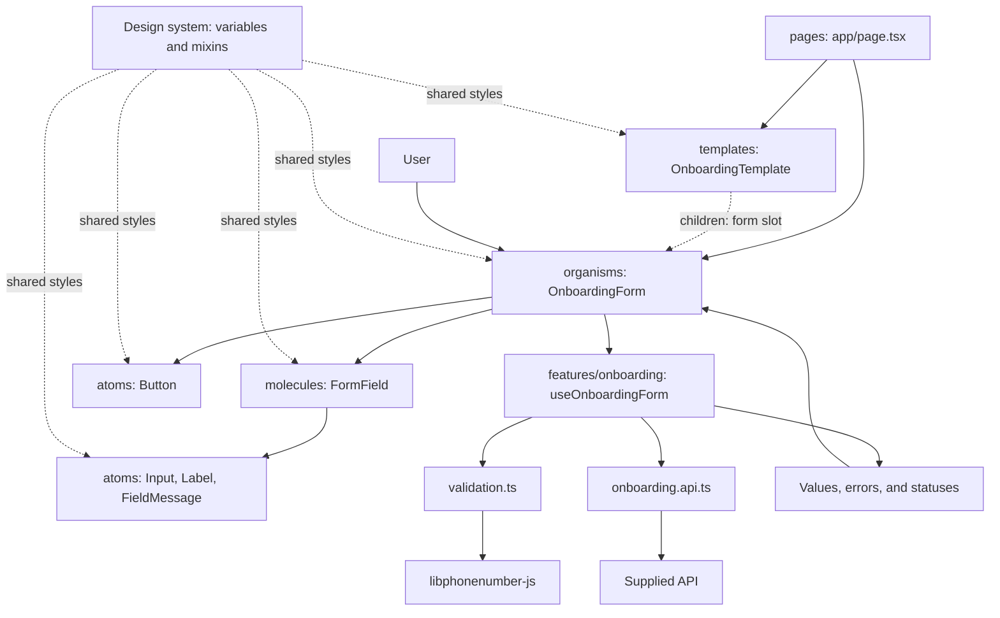
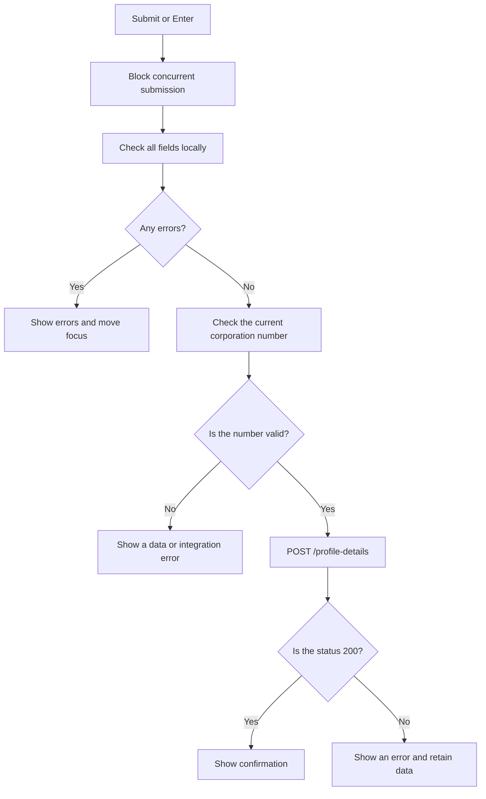

# Implementation plan: Onboarding Form

| Attribute                | Value                                                                                          |
| ------------------------ | ---------------------------------------------------------------------------------------------- |
| Status                   | Local implementation completed and verified on 2026-11-19.                                     |
| Source document          | [task.pdf](task.pdf), pages 1–4                                                                |
| Language                 | English. Technology names, identifiers, and filenames retain their original spelling.          |
| Application framework    | Next.js with App Router. Required by the user.                                                 |
| UI architecture          | Atomic Design: atoms, molecules, organisms, templates, and pages. Required by the user.        |
| Styles and design system | SCSS Modules. Shared variables and mixins as the single source of truth. Required by the user. |
| Editorial profile        | Plain technical English informed by ASD-STE100 simplified technical writing principles.        |
| Implementation approval  | The user approved the plan and implementation on 2026-11-19.                                   |

## Implementation results: 2026-11-19

The user approved implementation and assumptions A01–A14. They later requested that the repository remain local.
Publication and reviewer-access items remain open following that decision. CI does not apply to the local handoff.
P2 work was not implemented.

| Stage | Confirmed result                                                                                      |
| ----- | ----------------------------------------------------------------------------------------------------- |
| E0    | Read all four PDF pages and the mockup. Checked the API.                                              |
| E1    | Project created with create-next-app, strict mode, npm, Jest, RTL, and MSW. Clean installation works. |
| E2    | Local rules and payload covered by tests.                                                             |
| E3    | Adapter, response checks, timeouts, and cancellation covered by MSW tests.                            |
| E4    | Atomic Design, SCSS, and accessible fields. Token propagation checked in the browser.                 |
| E5    | Blur, version tracking, and shared GET requests verified by tests.                                    |
| E6    | Submit, locks, and submission outcomes verified by tests.                                             |
| E7    | All 65 tests, lint, types, and build passed. Startup, desktop, mobile, and CORS checked.              |
| E8    | README and report ready. Checks reproduced in a clean copy. Repository remains local.                 |

**Changes confirmed during implementation:**

- Node.js 26.13.1 LTS replaces the earlier Node.js 24 proposal.
- The latest compatible TypeScript is 6.0.3. The current typescript-eslint does not support TypeScript 7.
- The latest compatible ESLint is 9.39.5. The current Next.js plugins do not support ESLint 10.
- A12 was corrected: an invalid corporation returns HTTP 404 with a valid `valid: false` body.
- The live POST returned HTTP 200 with text `OK`. An empty body was tested with MSW.
- Live integration and preflight work from origin `http://localhost:3019`.
- After implementation, the onboarding module was divided into `api`, `model`, and `hooks` with a public `index.ts`. The [README architecture section](README.md#architecture) describes the current structure and import rules.

The [README](README.md) and [verification report](docs/VERIFICATION.md) document details, versions, sources, and limitations.
The remaining sections preserve the original planning assumptions and rationale. They describe the historical proposal; consult the README for the current implementation.

## Editorial principles

ASD-STE100 concerns controlled English. The standard contains writing rules and a dictionary of approved words.
This document follows transferable editorial principles and does not claim full linguistic compliance with ASD-STE100.
The basis is the [official information about the standard](https://www.asd-ste100.org/STE_faq.html).

Apply these principles when updating the plan:

1. Use one name for each concept.
2. Describe one action per step.
3. Start instructions with a verb.
4. Put conditions before conditional actions.
5. Use the active voice.
6. Limit instructional sentences to 20 words.
7. Limit descriptive sentences to 25 words.
8. Separate requirements, assumptions, and extensions.
9. State a verifiable result.

Sentence-length limits are part of the local editorial profile. They do not establish compliance with the STE dictionary.

### Labels

| Label | Meaning                                                   |
| ----- | --------------------------------------------------------- |
| R     | Requirement or information stated in the PDF.             |
| A     | Assumption or proposed technical decision.                |
| O     | Optional extension.                                       |
| P0    | Essential for complete functionality and handoff.         |
| P1    | Improves reliability, maintainability, or review quality. |
| P2    | Extension to consider after completing the core scope.    |

Priority does not indicate the source of a requirement. A decision labeled A may receive priority P0 if it ensures a correct flow.

### Terminology

| Term                   | Meaning                                                                                     |
| ---------------------- | ------------------------------------------------------------------------------------------- |
| Local validation       | Checking data without an HTTP request.                                                      |
| Remote validation      | Checking the corporation number through GET.                                                |
| Submission             | Sending form data through POST.                                                             |
| Value version          | An identifier that changes when the corporation number is edited.                           |
| Data error             | Data does not meet a validation rule.                                                       |
| Integration error      | The request outcome cannot be confirmed, or a valid response cannot be read.                |
| Protocol error         | The response has an unexpected status or structure.                                         |
| Design token           | A named visual value defined in `_variables.scss`.                                          |
| Design system          | Shared tokens, mixins, and rules used by all UI components.                                 |
| Single source of truth | One location defines values and shared visual rules. Other files consume those definitions. |

## 1. Summary

Build a React application with one form. The form collects first name, last name, Canadian phone number, and corporation number.
Validate fields when they lose focus. Check the corporation number through the supplied API. Submit only data that passes validation.

Use React, TypeScript, and Next.js with App Router. Put form logic in one custom hook. Separate local rules from HTTP communication.
Organize UI components using Atomic Design. Keep business rules and HTTP communication outside the component hierarchy.
Write styles in SCSS. Use a shared design system based on variables and mixins.
Verify important behaviors with automated integration tests.

### Initial investigation

- Read all four PDF pages.
- Checked the text layer and page images.
- Checked the mockup on page 4.
- The project directory contained the PDF and `.idea` files.
- No existing application or Git repository was found during analysis.
- GET attempts failed with DNS errors.
- The browsing tool also could not access the API.
- API responses and CORS configuration were not confirmed.
- No POST requests were made.

The analysis excludes materials that were not supplied. The PDF contains no Figma file, source fonts, or additional form views.

## 2. Requirements

### 2.1. Functional requirements

| ID  | Requirement                                                                                  | Source                       | Status |
| --- | -------------------------------------------------------------------------------------------- | ---------------------------- | ------ |
| F01 | Provide a simple form for personal and business details.                                     | p. 1, Challenge              | R      |
| F02 | Provide `firstName` with a 50-character limit.                                               | p. 2, User should be able to | R      |
| F03 | Provide `lastName` with a 50-character limit.                                                | p. 2                         | R      |
| F04 | Accept only valid Canadian phone numbers.                                                    | p. 2                         | R      |
| F05 | Require the `+1` prefix. Allow `+` only at the beginning. Allow no other special characters. | p. 2                         | R      |
| F06 | Require exactly 9 characters for the corporation number.                                     | p. 2                         | R      |
| F07 | Check the corporation number through an asynchronous GET request.                            | p. 2                         | R      |
| F08 | Handle `valid: true` and `valid: false` results.                                             | p. 2, response examples      | R      |
| F09 | Use the supplied numbers only as test data. Do not replace the API with a local list.        | pp. 2–3                      | R      |
| F10 | Require all four fields.                                                                     | p. 3                         | R      |
| F11 | Validate all fields on `onBlur`. Include remote corporation-number validation.               | p. 3                         | R      |
| F12 | Validate the form on Submit. Show missing-value messages below the corresponding fields.     | p. 3                         | R      |
| F13 | After successful validation, send data through POST.                                         | p. 3                         | R      |
| F14 | Send `firstName`, `lastName`, `corporationNumber`, and `phone`.                              | p. 3, request example        | R      |
| F15 | Handle POST success as HTTP `200` without requiring a body.                                  | p. 3                         | R      |
| F16 | Handle HTTP `400` with a backend error message.                                              | p. 3                         | R      |
| F17 | Use the supplied mockup as visual guidance.                                                  | pp. 1 and 4                  | R      |

### 2.2. Test data from the PDF

The document supplies these valid corporation numbers:

| Number      | Number      |
| ----------- | ----------- |
| `826417395` | `158739264` |
| `123456789` | `591863427` |
| `312574689` | `287965143` |
| `265398741` | `762354918` |
| `468721395` | `624719583` |

Put the necessary examples in test fixtures. Do not import fixtures into application code.

### 2.3. Mockup elements

Source: page 4 of the PDF. The requirement to use the design as guidance comes from page 1.

- Light gray background.
- Centered white card.
- Rounded corners and a subtle border.
- `Step 1 of 5` text.
- `Onboarding Form` heading.
- `First Name` and `Last Name` fields in one row.
- Full-width `Phone Number` and `Corporation Number` fields.
- Red error message below the corporation number.
- Black `Submit` button with an arrow.

The PDF does not require pixel-perfect matching. The example error in the mockup does not define the form's initial state.

### 2.4. Technologies and constraints

| ID  | Requirement or allowance            | Source  | Interpretation                                             |
| --- | ----------------------------------- | ------- | ---------------------------------------------------------- |
| T01 | React                               | p. 1    | Required.                                                  |
| T02 | Hooks, including custom hooks       | p. 1    | Required.                                                  |
| T03 | Standard React patterns             | p. 1    | Required.                                                  |
| T04 | TypeScript                          | p. 1    | Preferred. JavaScript is allowed.                          |
| T05 | External libraries                  | p. 1    | Allowed and recommended. No specific library is required.  |
| T06 | ESLint                              | p. 1    | Optional.                                                  |
| T07 | Vite or Next.js                     | p. 1    | The PDF allows either tool. The user selected Next.js.     |
| T08 | Supplied API                        | pp. 2–3 | Integration is required. A custom backend is not required. |
| T09 | Repository on a Git hosting service | p. 1    | Required. Any service is acceptable.                       |

**User decisions:** use Next.js with App Router. Apply Atomic Design to the UI architecture.
Use SCSS and a consistent design system. Variables and mixins are the single source of truth for application appearance.
These decisions supplement the PDF. Next.js runs and builds the application. Use Jest with the `next/jest` adapter for tests.

### 2.5. Quality requirements

| ID  | Expectation                                              | Source                     | Status               |
| --- | -------------------------------------------------------- | -------------------------- | -------------------- |
| Q01 | Code ready for PR review and treated as production code. | p. 1, Disclaimer           | R                    |
| Q02 | Appropriate separation of responsibilities into files.   | p. 1, Disclaimer           | R                    |
| Q03 | DRY principle.                                           | p. 1, Disclaimer           | R                    |
| Q04 | Automated integration tests for important behaviors.     | p. 1                       | R                    |
| Q05 | React Testing Library.                                   | p. 1                       | Document preference. |
| Q06 | Correct handling of API delays and failures.             | No details in PDF          | A                    |
| Q07 | Protection against stale responses.                      | No details in PDF          | A                    |
| Q08 | Keyboard support and accessible messages.                | No details in PDF          | A                    |
| Q09 | Layout that works on small screens.                      | No mobile variant supplied | A                    |
| Q10 | No unnecessary storage or logging of personal data.      | No details in PDF          | A                    |

The PDF specifies no SLA, load, or bundle-size limit. It specifies no WCAG level or supported-browser list.
Do not infer infrastructure requirements from these omissions.

### 2.6. Deliverables

| Deliverable                            | Status | Source                             |
| -------------------------------------- | ------ | ---------------------------------- |
| Code on a selected Git hosting service | R      | p. 1                               |
| Working form and API integration       | R      | pp. 1–3                            |
| Automated integration tests            | R      | p. 1                               |
| README                                 | A      | Simplifies setup and review.       |
| Lockfile and Node.js version           | A      | Ensure a reproducible environment. |
| CI                                     | O      | Not required.                      |
| Public deployment                      | O      | Not required.                      |
| Docker or a demonstration recording    | O      | Not required.                      |

The document does not require a public repository. Give the reviewer access to the code.

### 2.7. Evaluation criteria

The PDF identifies instruction compliance, React patterns, file organization, DRY, and integration tests.
It requires using the mockup as guidance. It specifies no scoring system or weights.

Additional anticipated reviewer criteria include:

- correct failure paths;
- recognition of Canadian numbers;
- control of asynchronous operations;
- readability;
- ease of setup;
- scope appropriate to the task.

These expectations are not additional PDF requirements.

## 3. Assumptions and questions

| ID  | Ambiguity                                                   | Proposed decision                                                              |
| --- | ----------------------------------------------------------- | ------------------------------------------------------------------------------ |
| A01 | Subsequent steps are not described.                         | Retain `Step 1 of 5`. Build only the specified form.                           |
| A02 | Corporation numbers have 9 characters. Examples use digits. | Check length. Do not add a local digits-only requirement.                      |
| A03 | No rules for outer whitespace in names.                     | Trim outer whitespace during validation and payload preparation.               |
| A04 | No character definition for the 50-character limit.         | Use UTF-16 code units, consistent with `String.length` and `maxLength`.        |
| A05 | No rules for shared numbers.                                | Require a valid number assigned to `CA` by the library.                        |
| A06 | No phone normalization rule.                                | Do not remove spaces, parentheses, or hyphens. Reject an incompatible format.  |
| A07 | No description of the screen after success.                 | Show confirmation on the same screen. Retain data.                             |
| A08 | POST errors contain only `message`.                         | Show a form-level message. Do not infer a field from its text.                 |
| A09 | No behavior specified for GET failures.                     | Block POST until the number is confirmed valid.                                |
| A10 | No timeout specified.                                       | Use 10 seconds per request. Define the limit in one place.                     |
| A11 | No authorization described.                                 | Assume HTTPS without tokens or cookies. Confirm during integration.            |
| A12 | No HTTP statuses specified for GET.                         | Expect a result in a 2xx response. Treat other statuses as integration errors. |
| A13 | No UI language specified.                                   | Use English, following the mockup.                                             |
| A14 | No mobile mockup supplied.                                  | Use a single column on small screens.                                          |

Assumption A04 does not count grapheme clusters. Do not add Unicode segmentation without a confirmed need.
Assumption A05 allows mobile and landline numbers. Do not restrict acceptance to mobile numbers.

### Questions requiring confirmation

1. Does the scope cover only the screen described in the PDF?
2. Must the corporation number contain only digits?
3. Is the supplied API available without additional access configuration?
4. Does the API allow requests from a local browser origin?

After plan approval, use the proposed decisions for unresolved product rules. Do not treat a missing answer as proof that the API works.

## 4. Technology stack

| Area                | Choice                                                         | Rationale                                                     |
| ------------------- | -------------------------------------------------------------- | ------------------------------------------------------------- |
| UI                  | React and React DOM                                            | PDF requirement.                                              |
| Language            | TypeScript, `strict`                                           | PDF preference and contract checking.                         |
| Framework and build | Next.js, App Router                                            | User choice; one screen at `/`.                               |
| UI architecture     | Atomic Design                                                  | User choice; five levels of interface composition.            |
| Environment         | Node.js 24 LTS and npm                                         | Supported release line and reproducible installation.         |
| State               | `useState`, `useRef`, `useOnboardingForm`                      | State belongs to one form.                                    |
| Phone               | `libphonenumber-js/max`                                        | Number validity and country assignment checks.                |
| HTTP                | `fetch`, `AbortController`                                     | Sufficient for two endpoints.                                 |
| Styles              | Sass, SCSS Modules                                             | `*.module.scss` files and global `globals.scss`; user choice. |
| Design system       | Shared Sass variables and mixins                               | Single source of truth for tokens and repeated visual rules.  |
| Tests               | Jest, `next/jest`, `jest-environment-jsdom`                    | Test configuration adapted to Next.js.                        |
| Interactions        | React Testing Library, `user-event`, `jest-dom`                | Checks behavior visible to users.                             |
| Test networking     | MSW                                                            | Tests the application's actual HTTP module.                   |
| Static checks       | ESLint, `eslint-config-next`, TypeScript and React Hooks rules | Detects common errors.                                        |

Select compatible package versions during initialization. Record them in `package-lock.json`. Pin the Node.js version in `.nvmrc`.

### Decisions and tradeoffs

**Local hook.** Four fields do not require a global store. One hook controls values, validation, and submission.
A custom hook requires explicit focus and error handling. Integration tests check these behaviors.

**No schema library.** Pure functions are sufficient for four fields. Do not add a form library, resolver, and schemas together.

**Atomic Design.** Use atoms, molecules, organisms, templates, and pages. This division concerns UI composition.
Rules, types, the hook, and the HTTP adapter remain in `features/onboarding`. Do not move business logic into atoms.
See the [method author's explanation of Atomic Design](https://atomicdesign.bradfrost.com/chapter-2/).

**SCSS and design system.** Add the `sass` package. Next.js supports SCSS and `*.module.scss` modules after this dependency is installed.
See [Sass support in Next.js](https://nextjs.org/docs/app/guides/sass).
Define visual values only in `styles/_variables.scss`. Define shared rules in `styles/_mixins.scss`.
Components access both through `styles/_index.scss`. Do not add a parallel set of tokens in components or TypeScript.

**Phone library.** Several countries share the `+1` prefix. Check the format, `isValid()`, and country `CA`.
The `max` metadata increases dependency size. It provides more detailed rules without a custom prefix directory.
See the [libphonenumber-js documentation](https://github.com/catamphetamine/libphonenumber-js).

**Next.js.** Use App Router as requested. Keep a simple separation between the page and form component.
Keep `layout.tsx` and `page.tsx` as synchronous Server Components. Mark `OnboardingForm.tsx` with `use client`.
Perform GET and POST directly from the browser. Do not add Server Actions or Route Handlers without a confirmed need.
See [Next.js installation](https://nextjs.org/docs/app/getting-started/installation).

**Next.js tests.** Put Jest configuration in `jest.config.ts`. Use `next/jest` to transform Next.js code.
Next.js and Jest serve different purposes. Test configuration does not replace `next.config.ts`.
Test the client form, rules, and HTTP adapter. Do not add asynchronous Server Components to this scope.
See [Jest configuration for Next.js](https://nextjs.org/docs/app/guides/testing/jest).

**No persistent cache.** Share only in-flight GET requests for the same value and version. Do not add TanStack Query or Redux.

## 5. Architecture and project structure

### 5.1. Atomic Design and data flow

Use the five Atomic Design levels:

| Level     | Elements                                   | Responsibility                                                 |
| --------- | ------------------------------------------ | -------------------------------------------------------------- |
| atoms     | `Button`, `Input`, `Label`, `FieldMessage` | Basic UI elements without form rules.                          |
| molecules | `FormField`                                | Composition of label, input, and message.                      |
| organisms | `OnboardingForm`                           | Composition of fields and button; connection to the form hook. |
| templates | `OnboardingTemplate`                       | Page layout, step indicator, and a slot for the form.          |
| pages     | `src/app/page.tsx`                         | The `/` page, combining template, content, and form.           |



The page passes `OnboardingForm` to `OnboardingTemplate` through `children`. The template does not import a specific form or its hook.
The organism displays state and forwards events. The hook manages the flow. Local rules do not depend on React or HTTP.
Atoms and molecules make no API requests. The HTTP adapter does not import components.

App Router exposes `/`. The server `page.tsx` connects the server template to the client organism.
Mark `OnboardingForm.tsx` with `use client`. Do not add this directive to the entire page or template.
Atoms and molecules used by the organism belong to its client graph. They need no separate directives without an independent reason.
Do not perform remote validation while rendering the page. Call the API after user events in the browser.

### 5.2. File structure

```text
venn/
├── task.pdf
├── IMPLEMENTATION_PLAN.md
├── README.md
├── package.json
├── package-lock.json
├── .gitignore
├── .nvmrc
├── .env.example
├── eslint.config.mjs
├── next.config.ts
├── next-env.d.ts
├── tsconfig.json
├── jest.config.ts
└── src/
    ├── app/
    │   ├── layout.tsx
    │   ├── page.tsx
    │   └── globals.scss
    ├── components/
    │   ├── atoms/
    │   │   ├── Button.tsx
    │   │   ├── Button.module.scss
    │   │   ├── Input.tsx
    │   │   ├── Input.module.scss
    │   │   ├── Label.tsx
    │   │   ├── Label.module.scss
    │   │   ├── FieldMessage.tsx
    │   │   └── FieldMessage.module.scss
    │   ├── molecules/
    │   │   ├── FormField.tsx
    │   │   ├── FormField.module.scss
    │   │   └── FormField.test.tsx
    │   ├── organisms/
    │   │   ├── OnboardingForm.tsx
    │   │   ├── OnboardingForm.module.scss
    │   │   └── OnboardingForm.test.tsx
    │   └── templates/
    │       ├── OnboardingTemplate.tsx
    │       └── OnboardingTemplate.module.scss
    ├── styles/
    │   ├── _variables.scss
    │   ├── _mixins.scss
    │   ├── _index.scss
    │   └── _reset.scss
    ├── config.ts
    ├── features/
    │   └── onboarding/
    │       ├── useOnboardingForm.ts
    │       ├── onboarding.types.ts
    │       ├── onboarding.api.ts
    │       ├── validation.ts
    │       ├── validation.test.ts
    │       └── onboarding.api.test.ts
    └── test/
        ├── polyfills.ts
        ├── setup.ts
        └── mocks/
            ├── server.ts
            └── handlers.ts
```

Next.js generates `next-env.d.ts`. Do not edit it manually. Exclude generated files and `.next` from the repository.
The `src/app` directory implements the pages level. Do not create an additional `src/pages` directory or duplicate the page in `components/pages`.
Each component uses its own SCSS Module when styles are needed. Put tests alongside the component or module they check.
Component SCSS files load the design system through `@use`. They do not define their own palette, spacing scale, or breakpoints.

### 5.3. Module responsibilities

| Module                                        | Responsibility                                                                         |
| --------------------------------------------- | -------------------------------------------------------------------------------------- |
| `app/layout.tsx`                              | Root layout, document language, and global style import.                               |
| `app/page.tsx`                                | Pages level: composition of template, step indicator, and form at `/`.                 |
| `app/globals.scss`                            | One-time reset and base typography using the design system.                            |
| `styles/_variables.scss`                      | Sole definitions of token values: colors, typography, spacing, dimensions, and states. |
| `styles/_mixins.scss`                         | Shared declaration patterns based on variables.                                        |
| `styles/_index.scss`                          | Public access through `@forward`; no selectors or global effects.                      |
| `styles/_reset.scss`                          | Minimal reset loaded only through `globals.scss`.                                      |
| `next.config.ts`                              | Minimal Next.js configuration.                                                         |
| `jest.config.ts`                              | Jest configuration through `next/jest`, jsdom environment, and setup files.            |
| `config.ts`                                   | API base URL with the default from the PDF.                                            |
| `components/atoms/Button.tsx`                 | Native button, style, `disabled`, and content.                                         |
| `components/atoms/Input.tsx`                  | Native input, HTML attributes, DOM ref, and events.                                    |
| `components/atoms/Label.tsx`                  | Label with `htmlFor`.                                                                  |
| `components/atoms/FieldMessage.tsx`           | Field message text and association ID.                                                 |
| `components/molecules/FormField.tsx`          | Atom composition; `id`, `htmlFor`, `aria-describedby`, and `aria-invalid`.             |
| `components/organisms/OnboardingForm.tsx`     | Client Component: four fields, heading, button, statuses, and form hook call.          |
| `components/templates/OnboardingTemplate.tsx` | Screen layout, step, and card container. Accepts `children` and `stepLabel`.           |
| `features/onboarding/useOnboardingForm.ts`    | State, events, remote validation, and submission.                                      |
| `features/onboarding/validation.ts`           | Local rules and payload preparation.                                                   |
| `features/onboarding/onboarding.api.ts`       | HTTP requests, response checks, and error classification.                              |
| `features/onboarding/onboarding.types.ts`     | Shared data and status types.                                                          |
| `test/polyfills.ts`                           | Missing test-environment Web APIs; runs before MSW imports.                            |
| `test/setup.ts`                               | Matchers, MSW lifecycle, and test cleanup.                                             |
| `test/mocks/*`                                | Controlled HTTP responses in tests.                                                    |

Do not turn `FormField` into a form generator. Do not add a repository layer, DI container, or event bus.

### Dependency rules

1. Import atoms into molecules.
2. Import molecules and atoms into organisms.
3. Connect the template and organism in the App Router page.
4. Pass values, errors, and events to molecules through props.
5. Forward the input ref to its DOM element.
6. Do not import organisms or business modules into atoms and molecules.
7. Do not add API calls to the template.
8. Limit global styles to the reset and base typography.
9. Load tokens and mixins through the public `styles/_index.scss` module.
10. Store visual values only in the shared design system.

The template owns the background, card width, and border. The organism owns field layout and form state.
An atom defines no field-specific rules. A molecule displays the supplied message without running validation.
Atomic Design does not require a separate component for every HTML tag. Create only elements used by this form.

### 5.4. Module contracts

| Name                      | Input                                              | Result                                        |
| ------------------------- | -------------------------------------------------- | --------------------------------------------- |
| `validateField`           | Field name and value                               | A message or no error.                        |
| `validateForm`            | Form values                                        | Errors for all fields.                        |
| `toProfileDetailsRequest` | Form values                                        | Payload with normalized names.                |
| `checkCorporationNumber`  | Number and `AbortSignal`                           | Business result or integration error.         |
| `submitProfileDetails`    | Payload and `AbortSignal`                          | Completion after HTTP `200` or an error.      |
| `useOnboardingForm`       | No arguments required by the UI                    | Values, errors, statuses, and event handlers. |
| `Input`                   | Native input attributes, DOM ref, and events       | Basic input without business validation.      |
| `FormField`               | `id`, label, input attributes, message, and events | Accessible composition of atoms.              |
| `OnboardingForm`          | No data required from the template                 | Organism using the form hook.                 |
| `OnboardingTemplate`      | `stepLabel` and `children`                         | Page layout independent of form state.        |

### 5.5. SCSS design system: single source of truth

The design system applies at every Atomic Design level. Values come from the mockup and chosen accessibility decisions.
The PDF provides no predefined tokens. Selecting tokens is an implementation task.

#### Definition ownership

| File              | Definitions                                       | Rule                                                                |
| ----------------- | ------------------------------------------------- | ------------------------------------------------------------------- |
| `_variables.scss` | Base values and semantic aliases.                 | Each value has one source. An alias refers to an existing variable. |
| `_mixins.scss`    | Shared visual rules.                              | Mixins use variables. They do not repeat token values.              |
| `_index.scss`     | Variables and mixins exported through `@forward`. | Consumers receive one public access point.                          |
| `*.module.scss`   | Local layout, selectors, and component states.    | Visual values and shared rules come from the design system.         |
| `globals.scss`    | Reset and base document styles.                   | Uses the same design system as components.                          |

#### Token scope

| Category        | Example identifiers                                                                                     | Use                                         |
| --------------- | ------------------------------------------------------------------------------------------------------- | ------------------------------------------- |
| Semantic colors | `$color-page`, `$color-surface`, `$color-text`, `$color-border`, `$color-danger`, `$color-focus`        | Background, text, border, error, and focus. |
| Action          | `$color-action`, `$color-on-action`, `$opacity-disabled`                                                | Button and disabled state.                  |
| Typography      | `$font-family-base`, `$font-size-body`, `$font-size-heading`, `$line-height-body`, `$font-weight-label` | Document and component text.                |
| Spacing         | `$space-1`, `$space-2`, `$space-3`, `$space-4`                                                          | Shared padding, margin, and gap scale.      |
| Borders         | `$border-width`, `$radius-control`, `$radius-card`                                                      | Inputs, button, and card.                   |
| Dimensions      | `$control-height`, `$container-width`                                                                   | Control height and card width.              |
| Focus           | `$focus-ring-width`, `$focus-ring-offset`                                                               | Consistent `focus-visible` indicator.       |
| Responsiveness  | `$breakpoint-mobile`                                                                                    | Form layout switching.                      |

Add only tokens needed by this application. If adding a shadow or animation, define its values in `_variables.scss`.

#### Mixin scope

| Mixin          | Responsibility                                                        |
| -------------- | --------------------------------------------------------------------- |
| `focus-ring`   | Shared focus appearance based on tokens.                              |
| `control-base` | Shared control declarations, including typography and minimum height. |
| `respond-to`   | Media query using only the centrally defined breakpoint.              |

A mixin does not replace a React atom. The atom owns the element and behavior. The mixin shares repeated style declarations.
Do not create a mixin that merely copies one variable. Do not build a general-purpose theme framework.

#### Usage rules

1. Define a token before its first use in a component.
2. Export variables and mixins through `@forward` in `_index.scss`.
3. In `_mixins.scss`, load variables directly through `@use`.
4. Do not import `_index.scss` from `_mixins.scss`.
5. In components, use `@use '@/styles' as design`.
6. In `globals.scss`, use `@use '@/styles' as design`.
7. Import `globals.scss` only in the root `app/layout.tsx`.
8. Load `_reset.scss` only through `globals.scss`.
9. Emit no standalone CSS rules from `_variables.scss`, `_mixins.scss`, or `_index.scss`.
10. Load colors, spacing, typography, radii, and breakpoints from variables.
11. Share repeated rules through mixins.
12. Do not write design values directly in TSX or local component styles.
13. Do not override tokens in individual modules.
14. Use `@use` and `@forward` instead of Sass `@import`.

Structural values such as `0`, `100%`, `auto`, and `inherit` need no separate tokens.
Grid layout may remain local. Its spacing and breakpoints must use the design system.

Do not create a second palette or scale in TypeScript, JSON, or global custom properties.
If custom properties are needed, derive their values from Sass variables. Do not maintain parallel manual definitions.
See the Sass documentation: [@use](https://sass-lang.com/documentation/at-rules/use/) and [@forward](https://sass-lang.com/documentation/at-rules/forward/).

## 6. Data, API, and behavior

### 6.1. Input model

Store all values as strings. The application needs no database or entity relationships.

| Field               | Local validation                                                               | Normalization                                           |
| ------------------- | ------------------------------------------------------------------------------ | ------------------------------------------------------- |
| `firstName`         | Required, maximum 50 characters.                                               | Trim outer whitespace before validation and submission. |
| `lastName`          | Required, maximum 50 characters.                                               | Same as `firstName`.                                    |
| `phone`             | Required, `+1` prefix, ASCII digits, library validity check, and country `CA`. | Do not correct the format automatically.                |
| `corporationNumber` | Required, exactly 9 characters.                                                | Do not convert to a number.                             |

Treat whitespace-only values as missing data.
Accept diacritics, apostrophes, hyphens, and internal spaces in names. The PDF does not prohibit them.
Preserve leading zeros in corporation numbers.

Name limits apply after normalization. Do not truncate data without notice. Check the limit in local rules.
If using HTML `maxLength`, keep it consistent with the normalization rule.

### 6.2. HTTP contracts

Base URL: `https://fe-hometask-api.qa.vault.tryvault.com`.
The `NEXT_PUBLIC_API_BASE_URL` variable may override it. The default configuration must work without creating `.env`.
Next.js embeds the public value in the bundle at build time. Create a new build after changing it.
See [Next.js environment variables](https://nextjs.org/docs/app/guides/environment-variables).

| Operation                         | PDF contract                                                  | Handling                              |
| --------------------------------- | ------------------------------------------------------------- | ------------------------------------- |
| `GET /corporation-number/:number` | `valid: true`; the example also includes `corporationNumber`. | Check types and the result.           |
| Invalid corporation               | `valid: false`, `message`.                                    | Show an error below the field.        |
| `POST /profile-details`           | JSON with four fields.                                        | Set `Content-Type: application/json`. |
| POST success                      | HTTP `200`.                                                   | Require neither JSON nor a body.      |
| POST error                        | HTTP `400`, `message`.                                        | Show a form-level message.            |

Example payload from the PDF:

| Key                 | Value          |
| ------------------- | -------------- |
| `firstName`         | `Hello`        |
| `lastName`          | `World`        |
| `corporationNumber` | `826417395`    |
| `phone`             | `+13062776103` |

Apply these adapter rules:

1. Encode the path parameter with `encodeURIComponent`.
2. Treat JSON as `unknown`.
3. Check that `valid` is a boolean.
4. For `valid: false`, check the documented text message.
5. If the response includes `corporationNumber`, check its type and match it to the requested value.
6. Ignore unknown extra fields.
7. Treat an incompatible structure as a protocol error.
8. For a POST error without a valid message, show fallback text.
9. Do not infer a field name from the backend message.

### 6.3. State model

| Element            | Contents                                                                            |
| ------------------ | ----------------------------------------------------------------------------------- |
| `values`           | Four current values.                                                                |
| `fieldErrors`      | Local validation errors.                                                            |
| `corporationCheck` | `idle`, `checking`, `valid`, `invalid`, or `unavailable`; number and value version. |
| `submitStatus`     | `idle`, `validating`, `submitting`, `success`, or `error`.                          |
| `formError`        | Submission message.                                                                 |

Do not add separate `touched` state if blur and submit events are sufficient to control errors.
Derive the visible corporation error from local validation and the remote result. Do not store multiple copies of the same error.

### 6.4. Validation on blur

1. Read the field's current value.
2. Check its local rules.
3. If a rule fails, show a message below the field.
4. If the corporation number passes local rules, start GET.
5. Show that the number is being checked.
6. If the response concerns the current version, save the result.
7. If the response concerns a previous version, ignore it.

Do not perform GET on every keystroke. The initial form shows no errors.

### 6.5. Asynchronous operation control

Keep the active `AbortController` in a ref. Store the version identifier and the in-flight GET promise.

When the corporation number changes:

1. Increment the value version.
2. Cancel the previous GET.
3. Invalidate the previous remote result.
4. Remove the remote message for the previous value.

Cancellation alone does not ensure correctness. A response may arrive before cancellation. Always check the result's version.

If blur and submit check the same value and version, share the in-flight GET.
Do not use completed results as a persistent cache. Check the number again before a new submission.
Cancel operations on unmount. Do not update state from their later results.

### 6.6. Submission



Use this procedure:

1. Handle the native `submit` event.
2. Check the immediate concurrent-submission lock.
3. Validate all fields locally.
4. If errors exist, show all messages.
5. If errors exist, focus the first invalid field.
6. If no errors exist, prevent editing during remote validation and submission.
7. Wait for the current GET result.
8. If the number is valid, prepare the payload.
9. Send POST.
10. Handle the response.
11. After an error, unlock the form.
12. After success, block further submissions until data is edited.

The button remains available when the form is empty. Users must be able to trigger the messages required by F12.
Use `noValidate` so browser messages do not replace application messages.
The ref lock must work before the next render. The `disabled` attribute alone does not protect the entire flow.

### 6.7. Errors and security

| Situation                           | Behavior                                        |
| ----------------------------------- | ----------------------------------------------- |
| Local error                         | Message below the field.                        |
| GET: `valid: false`                 | Corporation error below the field; no POST.     |
| GET: network, timeout, or 5xx       | Verification-unavailable message; no POST.      |
| GET: cancellation of an old version | No alarm message.                               |
| POST: HTTP `400`                    | Form-level message; retain data.                |
| POST: invalid response structure    | Fallback message.                               |
| POST: timeout or lost connection    | Explain that submission could not be confirmed. |

After a POST timeout, the server may already have processed the data. Do not state definitively that saving failed.
Do not retry POST automatically. The API documents no idempotency guarantees.

1. Use HTTPS.
2. Render backend messages as text.
3. Do not save form data in `localStorage`.
4. Do not put personal data in URLs or logs.
5. Do not add secrets to frontend configuration.
6. Do not use `no-cors` to work around server configuration.

Phone validation does not confirm number ownership or subscriber availability. The task does not require OTP.

## 7. Implementation roadmap

Complete stages in order. Add tests alongside behavior. Each stage must end with a reviewable change.

### E0. Confirm scope and integration

**Goal:** confirm interpretations and reduce external integration risk.

**Dependency:** explicit user approval for implementation.

**Files:** integration and assumptions sections in the eventual `README.md`.

**Tasks:**

1. Accept or revise assumptions A01–A14.
2. Retry GET for a valid example from the PDF.
3. Check the response for an invalid example.
4. Record HTTP statuses and actual response structures.
5. Check access requirements.
6. Plan a browser CORS check.

**Decision:** if the API remains unavailable, continue local work with MSW.

**Acceptance criteria:** product scope is agreed; unconfirmed API properties are identified.

**Verification:** compare observations with the PDF contract. Do not mark live integration complete without evidence.

### E1. Project and test environment

**Goal:** provide reproducible startup, builds, and tests.

**Dependency:** E0. API availability does not block this stage.

**Files:** root configurations, `src/app/layout.tsx`, `src/app/page.tsx`, `jest.config.ts`, `src/test/polyfills.ts`, `src/test/setup.ts`, `src/test/mocks/*`.

**Tasks:**

1. Create the Next.js project with `create-next-app` without deleting existing materials.
2. Enable TypeScript `strict`.
3. Add the agreed dependencies.
4. Configure Jest through `next/jest` in `jest.config.ts`.
5. Add `jest-dom` and MSW setup.
6. Fail tests on unhandled requests.
7. Add ESLint with `eslint-config-next` and React Hooks rules.
8. Add quality-check scripts.
9. Record the Node.js version and lockfile.
10. Initialize a local Git repository.
11. Create `components/atoms`, `components/molecules`, `components/organisms`, and `components/templates` directories.
12. Add `jest-environment-jsdom`, `@types/jest`, and `ts-node`, required by the test configuration.
13. Check Jest, jsdom, and MSW interoperability.
14. Add `sass` as a development dependency required during builds.

**Decision:** use npm as the only package manager.
Choose TypeScript, App Router, and the `src` directory. Use SCSS Modules.
If the generator requires an empty directory, prepare a template in a temporary directory. Then move files without overwriting project materials.
Configure missing Web APIs in `test/polyfills.ts` before importing MSW. Add only required test-environment polyfills.
If MSW dependencies require ESM transformation, adapt Jest configuration to the pinned versions.

**Acceptance criteria:** the application starts; build, type checking, and lint work; the test environment is ready.
The build supports SCSS without an additional bundler. Source stylesheets use the `.scss` extension.

**Verification:** run the commands in section 8.6. Add the first functional rendering test in E4.

### E2. Data and local rules

**Goal:** finalize input rules before connecting the UI.

**Dependency:** E1.

**Files:** `onboarding.types.ts`, `validation.ts`, `validation.test.ts`.

**Tasks:**

1. Define the four fields and payload.
2. Define the field-error type.
3. Add required-value checks.
4. Add name limits.
5. Add strict phone-format checks.
6. Add phone validity and country `CA` checks.
7. Add corporation-number length checks.
8. Add payload preparation.
9. Add boundary and format tests.

**Decision:** store values as strings. Share rules between blur and submit.

**Acceptance criteria:** valid examples pass; boundary values produce correct results; normalization is consistent.

**Verification:** run unit tests and type checking.

### E3. API adapter

**Goal:** separate transport from form behavior.

**Dependency:** E1–E2.

**Files:** `config.ts`, `.env.example`, `onboarding.api.ts`, `onboarding.api.test.ts`, `test/mocks/handlers.ts`.

**Tasks:**

1. Add a base URL with a default value.
2. Add GET with path-parameter encoding.
3. Add response-structure checks.
4. Add POST with the required JSON.
5. Handle empty HTTP `200` responses.
6. Add error classification.
7. Add timeouts and cancellation.
8. Ensure timer cleanup.
9. Add contract tests with MSW.

**Decision:** do not build a general-purpose API framework. Share only necessary transport logic.

**Acceptance criteria:** correct URLs, methods, and payload; empty success works; errors retain their categories.

**Verification:** run adapter tests and type checking.

### E4. Atomic Design components and form interface

**Goal:** build the shared design system, mockup structure, and accessible fields.

**Dependency:** E2. E3 can be completed independently of styling.

**Files:** `styles/_variables.scss`, `styles/_mixins.scss`, `styles/_index.scss`, `styles/_reset.scss`, `components/atoms/*`, `components/molecules/FormField.*`, `components/organisms/OnboardingForm.*`, `components/templates/OnboardingTemplate.*`, `app/globals.scss`, `app/layout.tsx`, `app/page.tsx`.

**Tasks:**

1. Define mockup tokens in `_variables.scss`.
2. Add `focus-ring`, `control-base`, and `respond-to` mixins.
3. Expose the design system through `_index.scss`.
4. Add the reset and base typography in global SCSS.
5. Add `Button`, `Input`, `Label`, and `FieldMessage` atoms with `*.module.scss` styles.
6. Build the `FormField` molecule from atoms.
7. Forward the input ref and accessibility attributes to the DOM element.
8. Build the `OnboardingForm` organism from four molecules and a button.
9. Add appropriate `autoComplete` values and `type="tel"` for the phone.
10. Use a text field for the corporation number.
11. Build `OnboardingTemplate` with slots for the step and form.
12. Add the mockup's card, background, and layout through shared tokens.
13. Connect the template and form in `app/page.tsx`.
14. Pass `Step 1 of 5` from the page to the template.
15. Add focus styles and mobile layout through shared mixins.
16. Prepare slots for operation statuses in the organism.
17. Add a `FormField` accessibility test and an initial organism rendering test.
18. Check that token changes propagate to every consuming component.

**Decision:** use `use client` in the form. Keep the layout and page as Server Components.
Use local SCSS Modules based on one design system. Define a system font in variables.
Do not add external font downloads without a need.

**Acceptance criteria:** mockup elements are visible; labels identify fields; the layout causes no horizontal scrolling.
Components follow Atomic Design dependency rules. Atoms and molecules import neither form logic nor the API.
Tokens have one source. Components do not duplicate design values. Shared rules come from mixins.

**Verification:** compare the view with page 4 of the PDF. Check keyboard navigation and a width of approximately 375 px.
Run the Next.js build. Check SCSS compilation and design-system usage following section 8.8.

### E5. Hook and validation on blur

**Goal:** connect state, local rules, and GET.

**Dependency:** E2–E4.

**Files:** `features/onboarding/useOnboardingForm.ts`, `components/organisms/OnboardingForm.tsx`, `components/organisms/OnboardingForm.test.tsx`.

**Tasks:**

1. Add the state from section 6.3.
2. Connect value changes.
3. Connect validation on blur.
4. Start GET after successful local corporation-number validation.
5. Invalidate the result when the number changes.
6. Add cancellation and version checks.
7. Add shared in-flight GET requests.
8. Handle unmounting.
9. Add error and response-ordering tests.

**Decision:** the hook is the sole owner of form state.

**Acceptance criteria:** blur triggers the appropriate check; stale results are ignored; failures are distinguished from data errors.

**Verification:** run integration tests with controlled responses.

### E6. Submit and submission outcomes

**Goal:** provide the complete flow required by the PDF.

**Dependency:** E5.

**Files:** `features/onboarding/useOnboardingForm.ts`, `components/organisms/OnboardingForm.tsx`, `components/organisms/OnboardingForm.test.tsx`.

**Tasks:**

1. Handle submission through the button and Enter.
2. Check all fields independently of earlier blur events.
3. Show errors and move focus.
4. Wait for the current GET result.
5. Add an immediate concurrent-submission lock.
6. Prevent editing during operations.
7. Send the required payload.
8. Handle HTTP `200` and `400`.
9. Handle failures and unconfirmed POST outcomes.
10. Retain data after errors.
11. Add full-flow tests.

**Decision:** do not retry POST automatically.

**Acceptance criteria:** an invalid form makes no POST; a valid form sends one payload; all outcomes are visible.

**Verification:** check request counts, GET/POST ordering, and exact body contents in tests.

### E7. Final verification

**Goal:** check behavior outside jsdom.

**Dependency:** E6.

**Files:** existing modules. Do not plan new architectural layers.

**Tasks:**

1. Check desktop and small screens.
2. Check focus, keyboard navigation, and messages.
3. Check slow responses and returning to editing.
4. Check the build with `npm run build` and `npm run start`.
5. If the API works, confirm GET in the browser.
6. If the API works, perform a controlled POST scenario.
7. Check CORS, including POST preflight.
8. Compare the actual contract with assumptions.
9. Remove unnecessary code and inconsistent messages.
10. Check for local copies of design tokens.
11. Check consistency of focus, errors, spacing, and typography.

**Decision:** do not treat mocked tests as confirmation of live integration.

**Acceptance criteria:** no known application errors; remaining external limitations are documented.

**Verification:** complete the manual checklist and all automated checks.

### E8. Documentation and handoff

**Goal:** enable setup and review without additional explanations.

**Dependency:** E7. Update documentation during earlier stages as well.

**Files:** `README.md`, `.env.example`, and configurations needing final adjustments.

**Tasks:**

1. Document the environment and commands.
2. Document assumptions and tradeoffs.
3. Describe test coverage.
4. Document live integration status.
5. Check installation from a clean copy.
6. Publish code to a selected Git hosting service.
7. Give the reviewer access.

**Decision:** deployment is not a handoff prerequisite.

**Acceptance criteria:** instructions work; the repository contains complete code and tests.

**Verification:** reproduce the README procedure without additional author-specific settings.

## 8. Tests and quality checks

### 8.1. Unit tests

| ID  | Scope             | Cases                                                                         |
| --- | ----------------- | ----------------------------------------------------------------------------- |
| U01 | Names             | Empty, whitespace-only, 50 and 51 characters.                                 |
| U02 | Name characters   | Diacritics, apostrophe, hyphen, internal space.                               |
| U03 | Valid phone       | `+13062776103` from the PDF.                                                  |
| U04 | Phone country     | US number with `+1`, another country, undetermined country.                   |
| U05 | Phone format      | Missing `+`, two `+` signs, spaces, parentheses, hyphens, letters, extension. |
| U06 | Length and digits | Too short, too long, non-ASCII digits.                                        |
| U07 | Corporation       | Lengths 0, 8, 9, and 10; whitespace-only.                                     |
| U08 | Local rule scope  | Leading zeros; no undocumented digits-only requirement.                       |
| U09 | Payload           | Exactly four keys and the agreed normalization.                               |

Test application rules. Do not recreate the phone library's full test suite.

Add molecule tests in `components/molecules/FormField.test.tsx`. Check the label, error description, and input access through its ref.
Do not add a separate test for every simple HTML wrapper. Also verify atoms through molecule and organism behavior.

### 8.2. Integration tests

Run tests through Jest with the `next/jest` adapter.
Render the actual `OnboardingForm` organism with molecules, atoms, the hook, and the API adapter. Use MSW to control networking.
Perform interactions through `user-event`. Find fields by labels and buttons by roles.
Do not mock atoms or molecules in form tests. Their connections are part of the behavior being verified.

| ID  | Scenario                                                          | Requirements |
| --- | ----------------------------------------------------------------- | ------------ |
| I01 | Initial view without errors or requests.                          | F01, F17; A  |
| I02 | Blurring an empty field shows its error.                          | F10–F11      |
| I03 | Correcting a field and blurring updates its error.                | F02–F06, F11 |
| I04 | Invalid corporation-number length does not trigger GET.           | F06–F07      |
| I05 | Blur at a valid length triggers GET. Typing does not trigger GET. | F07, F11     |
| I06 | Distinguish `valid: true` and `valid: false` results.             | F08          |
| I07 | Submitting an empty form shows four errors. No POST.              | F10, F12     |
| I08 | Valid data triggers POST with the required payload.               | F13–F14      |
| I09 | Submit without earlier blur triggers full validation.             | F12–F13      |
| I10 | POST waits for a valid GET result.                                | F07, F13     |
| I11 | Blur and submit share an in-flight GET.                           | Q06–Q07, A   |
| I12 | A late response does not validate an edited number.               | Q07, A       |
| I13 | Two rapid submissions do not create two active POST requests.     | Q06, A       |
| I14 | HTTP `200` with an empty body shows success.                      | F15          |
| I15 | HTTP `400` shows a message and retains data.                      | F16          |
| I16 | GET failure blocks POST and shows verification is unavailable.    | Q06, A       |
| I17 | POST failure shows a message without an automatic retry.          | Q06, A       |
| I18 | Enter triggers the same flow as the button.                       | Q08, A       |
| I19 | Unmounting cancels the request and invalidates the result.        | Q07, A       |
| I20 | Labels, ARIA, and focus identify invalid fields.                  | Q08, A       |

Control response ordering in concurrency tests. Check stale success and stale error cases.
Do not use arbitrary waits. Use a controlled clock only in tests that need to verify timeouts.
Reset handlers after each test. Do not allow tests to call the actual API.

### 8.3. HTTP adapter tests

| ID  | Scope                                           |
| --- | ----------------------------------------------- |
| H01 | GET URL and number encoding.                    |
| H02 | POST method, headers, and exact payload.        |
| H03 | `200` success without a body.                   |
| H04 | Invalid JSON and response structure.            |
| H05 | Mismatched number returned by GET.              |
| H06 | HTTP, timeout, and cancellation classification. |
| H07 | POST error without a valid `message`.           |

### 8.4. E2E

Optionally add one Playwright scenario with controlled networking.
Do not replace integration tests with it. Do not make automated tests depend on QA API availability.

### 8.5. Manual verification

1. Compare the form with the mockup.
2. Check desktop and a width of approximately 375 px.
3. Navigate the form using only the keyboard.
4. Check every rule on blur.
5. Submit an empty form.
6. Check a US number with `+1`.
7. Check a number containing spaces and hyphens.
8. Change the corporation number during a delayed GET.
9. Check lost connectivity and repeated verification.
10. Check CORS in the browser.
11. Check the production build output.

jsdom cannot verify appearance or actual CORS. These require a browser.
Jest mocks style imports. Passing Jest tests do not confirm SCSS compilation or visual accuracy.

### 8.6. Commands

| Command              | Script                         | Purpose                                          |
| -------------------- | ------------------------------ | ------------------------------------------------ |
| `npm ci`             | Not applicable.                | Installation matching the lockfile.              |
| `npm run dev`        | `next dev`                     | Local startup.                                   |
| `npm run lint`       | `eslint .`                     | Independent ESLint check.                        |
| `npm run typecheck`  | `next typegen && tsc --noEmit` | Next.js type generation and TypeScript checking. |
| `npm run test`       | `jest`                         | Single test run.                                 |
| `npm run test:watch` | `jest --watch`                 | Repeated tests during local development.         |
| `npm run test:run`   | `jest --ci`                    | Single test run in CI mode.                      |
| `npm run build`      | `next build`                   | Production build and type checking.              |
| `npm run start`      | `next start`                   | Run a previously prepared build.                 |

Run lint separately from the build. Base type configuration on the [Next.js TypeScript documentation](https://nextjs.org/docs/app/api-reference/config/typescript).

Do not set an arbitrary coverage percentage. Check the critical behaviors in the tables.

### 8.7. Requirements verified outside tests

| Scope              | Method                                                                |
| ------------------ | --------------------------------------------------------------------- |
| F09                | Review imports and runtime code.                                      |
| F17                | Visual comparison with page 4.                                        |
| T01–T04            | Review configuration and code.                                        |
| T09                | Reviewer access to the repository.                                    |
| Q01–Q03            | Review responsibilities, names, and duplication.                      |
| Q04–Q05            | Integration test results.                                             |
| Q09                | Browser layout review.                                                |
| Q10                | Review logging and data storage.                                      |
| Atomic Design      | Review directories, composition, and import direction. User decision. |
| SCSS design system | Review tokens, mixins, and consumers. User requirement.               |

### 8.8. Verify the single source of truth

1. Check that all source stylesheets use `.scss`.
2. Check that `globals.scss` is imported only in the root layout.
3. Check that token and mixin modules emit no standalone CSS rules.
4. Check that component SCSS uses the shared module.
5. Search for design colors and dimensions written outside `_variables.scss`.
6. Remove local token copies and unjustified overrides.
7. Temporarily change a shared token.
8. Check that all consuming components change.
9. Restore the target token value.
10. Check default, focus, error, and `disabled` states in the browser.
11. Run a Next.js build to verify Sass compilation.

When searching for literals, distinguish structural values from tokens. Do not require a variable for every number.
Do not add unit tests that merely duplicate color and spacing values.

## 9. Risks

| Risk                             | Effect                                                         | Mitigation                                                                  |
| -------------------------------- | -------------------------------------------------------------- | --------------------------------------------------------------------------- |
| Unavailable API                  | Live integration cannot be confirmed.                          | Early checks, MSW, and an explicit blocker list.                            |
| Incorrect CORS                   | Application does not work in the browser.                      | Check from the correct origin.                                              |
| Different API contract           | Incorrect response interpretation.                             | Adapter, runtime checks, and tests.                                         |
| Using only the `+1` prefix       | Accepting a number outside Canada.                             | Check country `CA`.                                                         |
| Stale GET response               | Validating an outdated value.                                  | Cancellation and version checks.                                            |
| Simultaneous blur and submit     | Duplicate GET or premature POST.                               | Shared promise and waiting for the result.                                  |
| Empty POST success               | JSON parsing failure.                                          | Handle status `200` without a body.                                         |
| Uncertain POST outcome           | Risk of duplication after retry.                               | No automatic retry and a clear message.                                     |
| Different phone validation       | Backend rejects data.                                          | Handle `400` and check live examples.                                       |
| Interpreting five steps          | Unsupported scope expansion.                                   | Assumption A01 and README explanation.                                      |
| Excessive abstraction            | Harder review and maintenance.                                 | One feature, one hook, small adapter.                                       |
| Business logic in atoms          | Harder component use and testing.                              | Props in atoms and molecules; hook and API outside UI.                      |
| Duplicate pages level            | Unclear composition location and risk of an additional router. | Pages level only in `src/app`.                                              |
| MSW/Jest incompatibility         | HTTP tests do not work.                                        | Check in E1; required Web APIs and transformation configuration.            |
| Duplicate design tokens          | Inconsistent appearance and expensive changes.                 | Definitions only in `_variables.scss`; review consumers.                    |
| Duplicate reset or global styles | Unpredictable cascade and a larger output stylesheet.          | Tokens and mixins emit no standalone CSS; global import only in the layout. |
| Unverified SCSS                  | UI tests pass despite a Sass error.                            | Next.js build and browser check.                                            |

Do not add a proxy merely to hide CORS locally. Infrastructure changes require a confirmed need and expanded scope.

## 10. Priorities and evaluation

### 10.1. P0

- [x] Next.js with App Router as requested.
- [x] Atomic Design: atoms, molecules, organisms, templates, and pages.
- [x] SCSS Modules and a shared design system.
- [x] Variables and mixins as the single source of truth, without local token copies.
- [x] React, hooks, and a custom hook.
- [x] Four fields and the PDF rules.
- [x] Required names and length limits.
- [x] Canadian phone number in the required format.
- [x] Corporation number of length 9.
- [x] GET on blur without a local list.
- [x] Full-form validation on submit.
- [x] Messages below the corresponding fields.
- [x] Wait for the current GET result.
- [x] Protection against stale GET results.
- [x] Required POST and payload.
- [x] Handle empty `200` and error `400` responses.
- [x] Appearance based on the mockup.
- [x] Integration tests for core paths.
- [ ] Repository accessible to the reviewer.

### 10.2. P1

- [x] TypeScript `strict`.
- [x] Timeouts, cancellation, and integration errors.
- [x] Shared in-flight GET requests.
- [x] Protection against duplicate POST requests.
- [x] Response-structure checks.
- [x] Focus and ARIA associations.
- [x] Mobile layout.
- [x] Failure and response-ordering tests.
- [x] Jest with `next/jest` and working MSW integration.
- [x] ESLint.
- [x] README, lockfile, and Node.js version.
- [x] Clean installation and build verification.
- [ ] Simple CI, if justified by the selected hosting.

### 10.3. P2

- [ ] One Playwright E2E test.
- [ ] Screenshot in the README.
- [ ] Automated accessibility audit.
- [ ] Deployment after confirming the need.
- [ ] Further visual refinement.

### 10.4. Relative effort

S means a small scope. M means several collaborating elements. L means more states and scenarios.

| Stage | Effort    | Uncertainty                                    |
| ----- | --------- | ---------------------------------------------- |
| E0    | S locally | High dependency on the API.                    |
| E1    | S         | Low.                                           |
| E2    | M         | Medium: phone and data interpretation.         |
| E3    | M         | Medium to high until API confirmation.         |
| E4    | M         | Medium: no source design specification.        |
| E5    | L         | Highest risk of asynchronous errors.           |
| E6    | M         | Medium.                                        |
| E7    | M         | Depends on the API and discovered differences. |
| E8    | S         | Low.                                           |

The PDF specifies no deadline or time budget. This table establishes no completion deadline.

### 10.5. Highest-impact evaluation factors

1. Ensure correct blur behavior, Canadian phone validation, and remote validation.
2. Ensure correct waiting for GET and interpretation of POST.
3. Provide integration tests for user scenarios.
4. Keep rules, state, and transport clearly separated.
5. Make setup simple and limitations explicit.

### 10.6. Decisions demonstrating technical maturity

- Separating data errors from service failures.
- Designing event ordering before implementation.
- Checking response versions in addition to cancellation.
- Avoiding automatic POST retries without idempotency guarantees.
- Using a phone library instead of a manual prefix list.
- Using Atomic Design with separate business logic and a limited component count.
- Keeping one token source and shared visual rules in SCSS.
- Testing behavior instead of hook implementation details.

### 10.7. Mistakes to avoid

- Remote validation only on submit.
- GET on every keystroke.
- Permanently disabling Submit for an empty form.
- Recognizing Canada solely through `+1`.
- A numeric corporation-number field.
- Hardcoding valid numbers.
- Treating HTTP `200` as `valid: true`.
- Parsing an empty POST success as JSON.
- Showing a data error during an API failure.
- Tests dependent on QA API availability.
- Adding unspecified steps or sign-in functionality.
- Duplicating colors, spacing, and breakpoints in components.
- Overriding tokens instead of changing the shared source.

### 10.8. README scope and tradeoffs

1. Describe scope and setup.
2. Describe quality-check commands.
3. Describe validation on blur and submit.
4. Describe country `CA` recognition.
5. Describe stale-response protection.
6. Describe contracts and live integration status.
7. Describe A01, A02, and data normalization.
8. Describe the Next.js choice, client/server boundary, and local hook.
9. Describe the absence of automatic POST retries.
10. Describe test and phone-metadata limitations.
11. Describe Atomic Design levels and the role of `src/app` as pages.
12. Describe Jest execution and `next/jest` configuration.
13. Describe tokens, mixins, and design-system extension.
14. Identify `_variables.scss` as the sole source of visual values.

Do not add a custom backend, database, or global store without a new requirement.
A form generator, Storybook, and Docker are unnecessary for this scope.

## 11. Definition of Done

- [x] The application uses Next.js with App Router.
- [x] The UI uses Atomic Design as described in section 5.
- [x] All source styles use SCSS.
- [x] Components use shared variables and mixins.
- [x] Tokens have one source and are not copied into components.
- [x] Changing a shared token updates all its consumers.
- [x] The Next.js build confirms successful SCSS compilation.
- [x] Atoms and molecules contain no business logic or API calls.
- [x] Requirements F01–F17 are implemented and verified.
- [x] Mandatory React and hooks requirements are met.
- [x] Code has a clear separation of responsibilities.
- [x] POST does not occur before successful validation.
- [x] A stale GET does not validate an edited value.
- [x] Empty success and backend errors are handled.
- [x] Tests cover the core flow and important failures.
- [x] Jest tests verify the actual organism, molecule, and atom composition.
- [x] Lint, type checks, tests, and build pass.
- [x] The form works with the keyboard and on small screens.
- [x] The README enables environment reproduction.
- [ ] The repository is accessible to the reviewer.
- [x] External limitations are documented.

Confirm live integration only after actual browser requests.
If the API remains unavailable, leave that item open. Completing local tests does not confirm the entire integration.

## 12. Implementation order

1. Approve scope interpretations.
2. Check API availability.
3. Prepare the project and test environment.
4. Define data and local rules.
5. Build the API adapter.
6. Define variables, mixins, and the public design-system module.
7. Add atoms, molecule, organism, and template with SCSS styles.
8. Add blur handling and response-version checks.
9. Add submit handling and all outcomes.
10. Complete tests and appearance.
11. Check the build and live integration.
12. Complete documentation.
13. Hand over the repository.
14. Consider P2 after completing the core scope.

Critical path: data model → local rules and API → asynchronous validation → submit → integration tests → final verification.
UI build order: variables and mixins → atoms → molecules → organisms → templates and App Router page.

Design the shared blur and submit flow before implementation. This order reduces state-management rework.
If the API is unavailable, continue independent stages. Live verification remains an external dependency.

## 13. Handoff checklist

- [ ] Repository link and reviewer access.
- [x] Complete code and integration tests.
- [x] Components organized using Atomic Design.
- [x] SCSS styles follow the shared design system.
- [x] No local token copies or parallel design definitions.
- [x] Tests configured through `next/jest`.
- [x] No list of valid corporations in runtime code.
- [x] Default API address matches the PDF.
- [x] Working `npm ci`.
- [x] Passing lint, type checks, tests, and build.
- [x] Next.js build checked through `npm run start`.
- [x] README with instructions and decisions.
- [x] Confirmed live integration or an explicit limitation statement.
- [x] No secrets or personal data in the repository.
- [x] No diagnostic logging of form data.
- [x] Appearance compared with the mockup.
- [x] No unspecified steps or features.

## Supporting sources

The PDF is the source of product requirements. Technical documentation supports the proposed decisions.

- [ASD-STE100: official information](https://www.asd-ste100.org/STE_faq.html).
- [ASD-STE100: standard overview](https://www.asd-ste100.org/about_STE.html).
- [Next.js: installation](https://nextjs.org/docs/app/getting-started/installation).
- [Next.js: Jest testing](https://nextjs.org/docs/app/guides/testing/jest).
- [Next.js: TypeScript](https://nextjs.org/docs/app/api-reference/config/typescript).
- [Next.js: environment variables](https://nextjs.org/docs/app/guides/environment-variables).
- [Next.js: Sass](https://nextjs.org/docs/app/guides/sass).
- [Sass: @use](https://sass-lang.com/documentation/at-rules/use/).
- [Sass: @forward](https://sass-lang.com/documentation/at-rules/forward/).
- [Node.js: releases](https://nodejs.org/en/about/previous-releases).
- [libphonenumber-js: documentation](https://github.com/catamphetamine/libphonenumber-js).
- [Atomic Design: method overview](https://atomicdesign.bradfrost.com/chapter-2/).
- [React Testing Library: introduction](https://testing-library.com/docs/react-testing-library/intro/).
- [MSW: documentation](https://mswjs.io/docs/).

ASD-STE100 information was checked in search results from official sites.
Direct access to the full standard returned HTTP `403`. No STE dictionary compliance audit was performed.

**Approval received:** the user requested implementation. E0–E8 were completed locally. Repository publication was left to the user at their explicit request.
