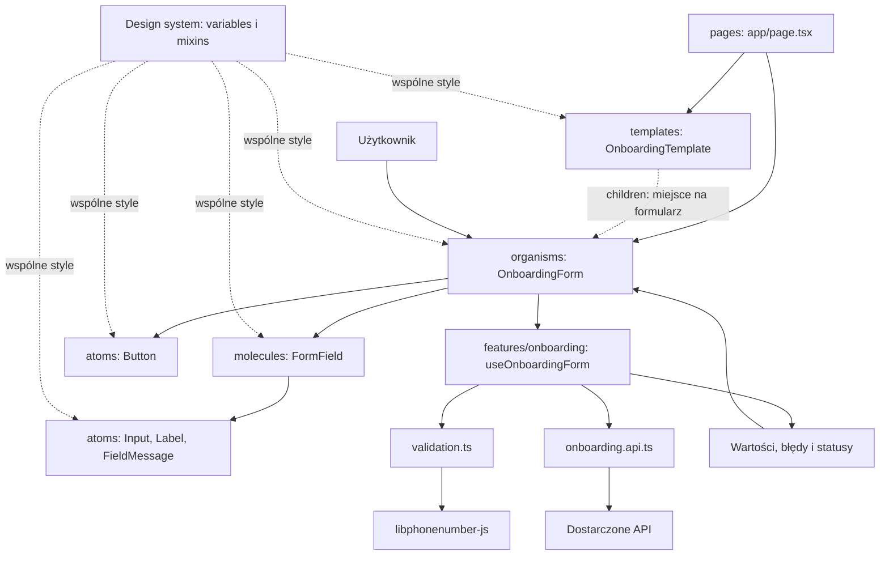
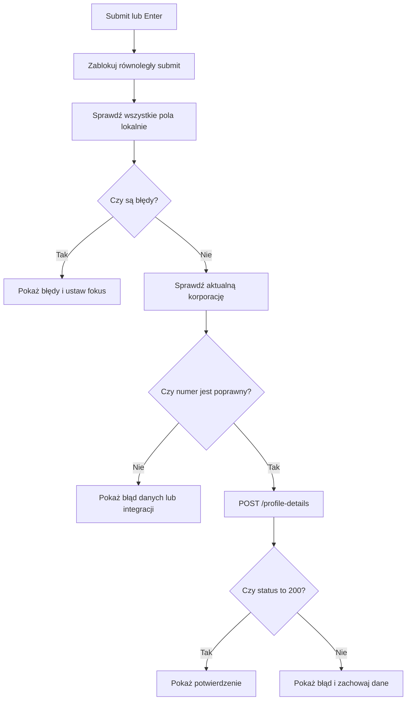

# Plan implementacji: Onboarding Form

| Atrybut | Wartość |
| --- | --- |
| Status | Implementacja lokalna ukończona i zweryfikowana 2026-11-19. |
| Dokument źródłowy | [task.pdf](task.pdf), strony 1–4 |
| Język | Polski. Nazwy technologii, identyfikatory i nazwy plików pozostają w języku angielskim. |
| Framework aplikacji | Next.js z App Router. Wybór wymagany przez użytkownika. |
| Architektura UI | Atomic Design: atoms, molecules, organisms, templates i pages. Wybór wymagany przez użytkownika. |
| Style i design system | SCSS Modules. Wspólne variables i mixins jako single source of truth. Wymaganie użytkownika. |
| Profil redakcyjny | Polska adaptacja zasad uproszczonego języka technicznego ASD-STE100. |
| Zgoda na implementację | Użytkownik zatwierdził plan i rozpoczęcie implementacji 2026-11-19. |

## Wynik implementacji: 2026-11-19

Użytkownik zatwierdził implementację oraz założenia A01–A14. Później zlecił pozostawienie repozytorium lokalnego.
Punkty publikacji i dostępu recenzenta pozostają otwarte zgodnie z tą decyzją. CI nie dotyczy lokalnego przekazania.
Nie realizowano P2.

| Etap | Potwierdzony wynik |
| --- | --- |
| E0 | Odczytano cztery strony PDF i makietę. Sprawdzono API. |
| E1 | Projekt z create-next-app, strict, npm, Jest, RTL i MSW. Czysta instalacja działa. |
| E2 | Reguły lokalne i payload pokryte testami. |
| E3 | Adapter, kontrola odpowiedzi, timeout i anulowanie pokryte testami MSW. |
| E4 | Atomic Design, SCSS i dostępne pola. Propagacja tokenu sprawdzona w przeglądarce. |
| E5 | Blur, wersjonowanie i współdzielenie GET sprawdzone testami. |
| E6 | Submit, blokady i wyniki wysyłki sprawdzone testami. |
| E7 | 65 testów, lint, typy i build przechodzą. Sprawdzono start, desktop, mobile i CORS. |
| E8 | README i raport gotowe. Odtworzono kontrole w czystej kopii. Repozytorium pozostaje lokalne. |

**Zmiany potwierdzone podczas implementacji:**

- Node.js 26.13.1 LTS zastępuje wcześniejszą propozycję Node.js 24.
- Najnowszy zgodny TypeScript to 6.0.3. Aktualny typescript-eslint nie obsługuje TypeScript 7.
- Najnowszy zgodny ESLint to 9.39.5. Aktualne pluginy Next.js nie obsługują ESLint 10.
- A12 skorygowano: niepoprawna korporacja zwraca HTTP 404 i poprawne body `valid: false`.
- Live POST zwrócił HTTP 200 z tekstem `OK`. Puste body sprawdzono z MSW.
- Integracja live i preflight działają z originu `http://localhost:3019`.

Szczegóły, wersje, źródła i ograniczenia opisują [README](README.md) oraz [raport weryfikacji](docs/VERIFICATION.md).
Pozostałe sekcje zachowują pierwotne założenia i uzasadnienia planu.

## Zasady redakcyjne

ASD-STE100 dotyczy kontrolowanego języka angielskiego. Standard zawiera reguły pisania i słownik zatwierdzonych słów.
Polski dokument stosuje możliwe do przeniesienia zasady redakcyjne. Dokument nie deklaruje pełnej zgodności językowej z ASD-STE100.
Podstawę stanowią [oficjalne informacje o standardzie](https://www.asd-ste100.org/STE_faq.html).

Stosuj następujące zasady podczas aktualizacji planu:

1. Stosuj jedną nazwę dla jednego pojęcia.
2. Opisuj jedną czynność w jednym kroku.
3. Rozpoczynaj instrukcje od czasownika.
4. Podawaj warunek przed czynnością warunkową.
5. Stosuj stronę czynną.
6. Ogranicz zdania instrukcji do 20 słów.
7. Ogranicz zdania opisowe do 25 słów.
8. Oddzielaj wymagania, założenia i rozszerzenia.
9. Podawaj wynik, który można sprawdzić.

Limity długości zdań są częścią lokalnego profilu redakcyjnego. Nie stanowią deklaracji zgodności polskiego tekstu ze słownikiem STE.

### Oznaczenia

| Oznaczenie | Znaczenie |
| --- | --- |
| W | Wymaganie albo informacja podana w PDF. |
| Z | Założenie albo proponowana decyzja techniczna. |
| O | Opcjonalne rozszerzenie. |
| P0 | Element niezbędny do kompletnego działania i przekazania rozwiązania. |
| P1 | Element poprawiający niezawodność, utrzymanie albo jakość oceny. |
| P2 | Rozszerzenie do realizacji po ukończeniu podstawowego zakresu. |

Priorytet nie określa źródła wymagania. Decyzja oznaczona jako Z może otrzymać priorytet P0, jeśli zapewnia poprawność przepływu.

### Terminologia

| Termin | Znaczenie |
| --- | --- |
| Walidacja lokalna | Sprawdzenie danych bez żądania HTTP. |
| Walidacja zdalna | Sprawdzenie numeru korporacji przez GET. |
| Wysyłka | Przekazanie danych formularza przez POST. |
| Wersja wartości | Identyfikator zmieniany po edycji numeru korporacji. |
| Błąd danych | Dane nie spełniają reguły walidacji. |
| Błąd integracji | Nie można potwierdzić wyniku żądania lub odczytać poprawnej odpowiedzi. |
| Błąd protokołu | Odpowiedź nie ma oczekiwanego statusu albo struktury. |
| Design token | Nazwana wartość wizualna zdefiniowana w `_variables.scss`. |
| Design system | Wspólne tokeny, mixiny i zasady stosowane przez wszystkie komponenty UI. |
| Single source of truth | Jedno miejsce definicji wartości i wspólnych reguł wizualnych. Pozostałe pliki korzystają z tych definicji. |

## 1. Podsumowanie

Zbuduj aplikację React z jednym formularzem. Formularz zbiera imię, nazwisko, kanadyjski numer telefonu i numer korporacji.
Waliduj pola po utracie fokusu. Sprawdzaj numer korporacji przez dostarczone API. Wysyłaj wyłącznie dane, które przeszły walidację.

Zastosuj React, TypeScript i Next.js z App Router. Umieść logikę formularza w jednym custom hooku. Wydziel reguły lokalne i komunikację HTTP.
Zorganizuj komponenty UI według Atomic Design. Zachowaj reguły biznesowe i komunikację HTTP poza hierarchią komponentów.
Zapisuj style w SCSS. Korzystaj ze wspólnego design systemu opartego na variables i mixins.
Sprawdź istotne zachowania automatycznymi testami integracyjnymi.

### Stan rozpoznania

- Odczytano wszystkie cztery strony PDF.
- Sprawdzono warstwę tekstową i obrazy stron.
- Sprawdzono makietę na stronie 4.
- Katalog projektu zawierał PDF i pliki `.idea`.
- Nie znaleziono istniejącej aplikacji ani repozytorium Git podczas analizy.
- Próby GET zakończyły się błędem DNS.
- Narzędzie przeglądania również nie uzyskało dostępu do API.
- Nie potwierdzono odpowiedzi API ani konfiguracji CORS.
- Nie wykonano żądań POST.

Analiza nie obejmuje nieudostępnionych materiałów. PDF nie zawiera pliku Figma, źródłowych fontów ani dodatkowych widoków formularza.

## 2. Wymagania

### 2.1. Wymagania funkcjonalne

| ID | Wymaganie | Źródło | Status |
| --- | --- | --- | --- |
| F01 | Udostępnij prosty formularz danych osobowych i firmowych. | s. 1, Challenge | W |
| F02 | Udostępnij `firstName` z limitem 50 znaków. | s. 2, User should be able to | W |
| F03 | Udostępnij `lastName` z limitem 50 znaków. | s. 2 | W |
| F04 | Akceptuj wyłącznie poprawne kanadyjskie numery telefonu. | s. 2 | W |
| F05 | Wymagaj prefiksu `+1`. Dopuść znak `+` wyłącznie na początku. Nie dopuszczaj innych znaków specjalnych. | s. 2 | W |
| F06 | Wymagaj dokładnie 9 znaków numeru korporacji. | s. 2 | W |
| F07 | Sprawdzaj numer korporacji asynchronicznym żądaniem GET. | s. 2 | W |
| F08 | Obsłuż wyniki `valid: true` i `valid: false`. | s. 2, przykłady odpowiedzi | W |
| F09 | Używaj podanych numerów wyłącznie jako danych testowych. Nie zastępuj API listą lokalną. | s. 2–3 | W |
| F10 | Wymagaj wszystkich czterech pól. | s. 3 | W |
| F11 | Waliduj wszystkie pola po `onBlur`. Uwzględnij walidację zdalną numeru korporacji. | s. 3 | W |
| F12 | Po Submit zweryfikuj formularz. Pokaż komunikaty o brakujących danych pod odpowiednimi polami. | s. 3 | W |
| F13 | Po poprawnej walidacji wyślij dane metodą POST. | s. 3 | W |
| F14 | Wyślij `firstName`, `lastName`, `corporationNumber` i `phone`. | s. 3, przykład żądania | W |
| F15 | Obsłuż sukces POST jako HTTP `200` bez wymaganego body. | s. 3 | W |
| F16 | Obsłuż HTTP `400` z komunikatem błędu backendu. | s. 3 | W |
| F17 | Wykorzystaj dostarczoną makietę jako wskazówkę wyglądu. | s. 1 i 4 | W |

### 2.2. Dane testowe z PDF

Dokument podaje następujące poprawne numery korporacji:

| Numer | Numer |
| --- | --- |
| `826417395` | `158739264` |
| `123456789` | `591863427` |
| `312574689` | `287965143` |
| `265398741` | `762354918` |
| `468721395` | `624719583` |

Umieść potrzebne przykłady w fixtures testów. Nie importuj fixtures do kodu aplikacji.

### 2.3. Elementy makiety

Źródło: strona 4 PDF. Obowiązek wykorzystania projektu jako wskazówki wynika ze strony 1.

- Jasnoszare tło.
- Centralna biała karta.
- Zaokrąglenia i delikatne obramowanie.
- Tekst `Step 1 of 5`.
- Nagłówek `Onboarding Form`.
- Pola `First Name` i `Last Name` w jednym rzędzie.
- Pola `Phone Number` i `Corporation Number` na pełną szerokość.
- Czerwony komunikat błędu pod numerem korporacji.
- Czarny przycisk `Submit` ze strzałką.

PDF nie wymaga zgodności pixel-perfect. Przykład błędu na makiecie nie określa początkowego stanu formularza.

### 2.4. Technologie i ograniczenia

| ID | Wymaganie lub dopuszczenie | Źródło | Interpretacja |
| --- | --- | --- | --- |
| T01 | React | s. 1 | Wymagany. |
| T02 | Hooks, w tym custom hooks | s. 1 | Wymagane. |
| T03 | Standardowe wzorce React | s. 1 | Wymagane. |
| T04 | TypeScript | s. 1 | Preferowany. JavaScript jest dopuszczalny. |
| T05 | Biblioteki zewnętrzne | s. 1 | Dozwolone i zalecane. Brak obowiązku użycia konkretnej biblioteki. |
| T06 | ESLint | s. 1 | Opcjonalny. |
| T07 | Vite lub Next.js | s. 1 | PDF dopuszcza oba narzędzia. Użytkownik wybrał Next.js. |
| T08 | Dostarczone API | s. 2–3 | Wymagana integracja. Własny backend nie jest wymagany. |
| T09 | Repozytorium na serwisie Git | s. 1 | Wymagane. Serwis jest dowolny. |

**Decyzje użytkownika:** użyj Next.js z App Router. Zastosuj Atomic Design w architekturze UI.
Stosuj SCSS i spójny design system. Variables i mixins stanowią single source of truth dla wyglądu aplikacji.
Te decyzje uzupełniają PDF. Next.js uruchamia i buduje aplikację. Do testów zastosuj Jest z adapterem `next/jest`.

### 2.5. Wymagania jakościowe

| ID | Oczekiwanie | Źródło | Status |
| --- | --- | --- | --- |
| Q01 | Kod przygotowany do przeglądu PR i traktowany jako produkcyjny. | s. 1, Disclaimer | W |
| Q02 | Właściwy podział odpowiedzialności na pliki. | s. 1, Disclaimer | W |
| Q03 | Zasada DRY. | s. 1, Disclaimer | W |
| Q04 | Automatyczne testy integracyjne istotnych zachowań. | s. 1 | W |
| Q05 | React Testing Library. | s. 1 | Preferencja dokumentu. |
| Q06 | Poprawna obsługa opóźnień i awarii API. | Brak szczegółów w PDF | Z |
| Q07 | Ochrona przed nieaktualnymi odpowiedziami. | Brak szczegółów w PDF | Z |
| Q08 | Obsługa klawiatury i dostępne komunikaty. | Brak szczegółów w PDF | Z |
| Q09 | Układ działający na małych ekranach. | Brak wariantu mobilnego | Z |
| Q10 | Brak zbędnego przechowywania i logowania danych osobowych. | Brak szczegółów w PDF | Z |

PDF nie określa SLA, obciążenia ani limitu wielkości bundle. Nie określa poziomu WCAG ani listy obsługiwanych przeglądarek.
Nie dodawaj wymagań infrastrukturalnych na podstawie tych braków.

### 2.6. Materiały do przekazania

| Materiał | Status | Źródło |
| --- | --- | --- |
| Kod na wybranym serwisie Git | W | s. 1 |
| Działający formularz i integracja API | W | s. 1–3 |
| Automatyczne testy integracyjne | W | s. 1 |
| README | Z | Ułatwia uruchomienie i ocenę. |
| Lockfile i wersja Node.js | Z | Zapewniają powtarzalność środowiska. |
| CI | O | Brak wymagania. |
| Publiczny deployment | O | Brak wymagania. |
| Docker lub nagranie demonstracyjne | O | Brak wymagania. |

Dokument nie wymaga publicznego repozytorium. Zapewnij recenzentowi dostęp do kodu.

### 2.7. Kryteria oceny

PDF wskazuje zgodność z instrukcjami, wzorce React, podział plików, DRY i testy integracyjne.
PDF wymaga wykorzystania makiety jako wskazówki. Nie podaje punktacji ani wag oceny.

Przewidywane kryteria recenzenta obejmują dodatkowo:

- poprawność błędnych ścieżek;
- rozpoznawanie numerów kanadyjskich;
- kontrolę operacji asynchronicznych;
- czytelność rozwiązania;
- łatwość uruchomienia;
- zakres odpowiedni do zadania.

Te przewidywania nie są dodatkowymi wymaganiami PDF.

## 3. Założenia i pytania

| ID | Niejasność | Proponowana decyzja |
| --- | --- | --- |
| A01 | Brak opisu kolejnych kroków. | Zachowaj `Step 1 of 5`. Zbuduj tylko opisany formularz. |
| A02 | Numer korporacji ma 9 znaków. Przykłady zawierają cyfry. | Sprawdzaj długość. Nie dodawaj lokalnego wymogu samych cyfr. |
| A03 | Brak reguł zewnętrznych spacji w nazwach. | Usuń zewnętrzne białe znaki podczas walidacji i przygotowania payloadu. |
| A04 | Brak definicji znaku dla limitu 50. | Stosuj jednostki UTF-16 zgodnie z `String.length` i `maxLength`. |
| A05 | Brak zasad dla numerów współdzielonych. | Wymagaj poprawnego numeru przypisanego przez bibliotekę do `CA`. |
| A06 | Brak reguły normalizacji telefonu. | Nie usuwaj spacji, nawiasów ani myślników. Odrzucaj niezgodny format. |
| A07 | Brak opisu ekranu po sukcesie. | Pokaż potwierdzenie na tym samym ekranie. Zachowaj dane. |
| A08 | Błąd POST zawiera tylko `message`. | Pokaż komunikat na poziomie formularza. Nie odgaduj pola z tekstu. |
| A09 | Brak zachowania przy awarii GET. | Zablokuj POST do czasu potwierdzenia poprawności numeru. |
| A10 | Brak timeoutu. | Przyjmij 10 sekund na żądanie. Umieść limit w jednym miejscu. |
| A11 | Brak opisu autoryzacji. | Przyjmij połączenie HTTPS bez tokenów i cookies. Potwierdź podczas integracji. |
| A12 | Brak statusów HTTP dla GET. | Oczekuj wyniku w odpowiedzi 2xx. Inne statusy traktuj jako błąd integracji. |
| A13 | Brak wskazanego języka UI. | Zastosuj angielski zgodnie z makietą. |
| A14 | Brak makiety mobilnej. | Zastosuj jedną kolumnę na małym ekranie. |

Założenie A04 nie zapewnia liczenia klastrów grafemowych. Nie dodawaj segmentacji Unicode bez potwierdzonej potrzeby.
Założenie A05 dopuszcza numery komórkowe i stacjonarne. Nie wprowadzaj ograniczenia do numerów komórkowych.

### Pytania wymagające potwierdzenia

1. Czy zakres obejmuje wyłącznie ekran opisany w PDF?
2. Czy numer korporacji musi zawierać wyłącznie cyfry?
3. Czy dostarczone API jest dostępne bez dodatkowej konfiguracji dostępu?
4. Czy API dopuszcza żądania z lokalnego originu przeglądarki?

Po akceptacji planu przyjmij proponowane decyzje dla nierozstrzygniętych reguł produktu. Nie uznawaj braku odpowiedzi za potwierdzenie działania API.

## 4. Stack technologiczny

| Obszar | Wybór | Uzasadnienie |
| --- | --- | --- |
| UI | React i React DOM | Wymaganie PDF. |
| Język | TypeScript, `strict` | Preferencja PDF i kontrola kontraktów. |
| Framework i build | Next.js, App Router | Wybór użytkownika; jeden ekran pod ścieżką `/`. |
| Architektura UI | Atomic Design | Wybór użytkownika; pięć poziomów kompozycji interfejsu. |
| Środowisko | Node.js 24 LTS i npm | Wspierana linia i powtarzalna instalacja. |
| Stan | `useState`, `useRef`, `useOnboardingForm` | Stan dotyczy jednego formularza. |
| Telefon | `libphonenumber-js/max` | Walidacja numeru i przypisania kraju. |
| HTTP | `fetch`, `AbortController` | Wystarczające dla dwóch endpointów. |
| Style | Sass, SCSS Modules | Pliki `*.module.scss` i globalny `globals.scss`; wybór użytkownika. |
| Design system | Wspólne variables i mixins Sass | Single source of truth dla tokenów i powtarzalnych reguł wizualnych. |
| Testy | Jest, `next/jest`, `jest-environment-jsdom` | Konfiguracja testów dostosowana do Next.js. |
| Interakcje | React Testing Library, `user-event`, `jest-dom` | Sprawdzanie zachowania widocznego dla użytkownika. |
| Sieć w testach | MSW | Testowanie rzeczywistego modułu HTTP aplikacji. |
| Kontrola statyczna | ESLint, `eslint-config-next`, reguły TypeScript i React Hooks | Wykrywanie typowych błędów. |

Dobierz zgodne wersje pakietów podczas inicjalizacji. Zapisz je w `package-lock.json`. Przypnij wersję Node.js w `.nvmrc`.

### Decyzje i kompromisy

**Lokalny hook.** Cztery pola nie wymagają globalnego store. Jeden hook kontroluje wartości, walidację i wysyłkę.
Własny hook wymaga samodzielnej obsługi fokusu i błędów. Testy integracyjne sprawdzają te zachowania.

**Brak biblioteki schematów.** Czyste funkcje wystarczą do czterech pól. Nie dodawaj jednocześnie biblioteki formularzy, resolvera i schematów.

**Atomic Design.** Zastosuj atoms, molecules, organisms, templates i pages. Podział dotyczy kompozycji UI.
Reguły, typy, hook i adapter HTTP pozostają w `features/onboarding`. Nie przenoś logiki biznesowej do atomów.
Zobacz [opis Atomic Design autora metody](https://atomicdesign.bradfrost.com/chapter-2/).

**SCSS i design system.** Dodaj pakiet `sass`. Next.js obsługuje SCSS i moduły `*.module.scss` po instalacji tej zależności.
Zobacz [obsługę Sass w Next.js](https://nextjs.org/docs/app/guides/sass).
Zdefiniuj wartości wizualne wyłącznie w `styles/_variables.scss`. Zdefiniuj współdzielone reguły w `styles/_mixins.scss`.
Komponenty pobierają oba zasoby przez `styles/_index.scss`. Nie dodawaj równoległego zestawu tokenów w komponentach ani TypeScript.

**Biblioteka telefonu.** Prefiks `+1` jest współdzielony przez kilka krajów. Sprawdzaj format, `isValid()` oraz kraj `CA`.
Metadane `max` zwiększają rozmiar zależności. Zapewniają dokładniejsze reguły bez własnego katalogu prefiksów.
Zobacz [dokumentację libphonenumber-js](https://github.com/catamphetamine/libphonenumber-js).

**Next.js.** Zastosuj App Router zgodnie z decyzją użytkownika. Zachowaj prosty podział na stronę i komponent formularza.
Utrzymaj `layout.tsx` i `page.tsx` jako synchroniczne Server Components. Oznacz `OnboardingForm.tsx` dyrektywą `use client`.
Wykonuj GET i POST bezpośrednio z przeglądarki. Nie dodawaj Server Actions ani Route Handlers bez potwierdzonej potrzeby.
Zobacz [instalację Next.js](https://nextjs.org/docs/app/getting-started/installation).

**Testy Next.js.** Umieść konfigurację Jest w `jest.config.ts`. Użyj adaptera `next/jest` do transformacji kodu Next.js.
Next.js i Jest mają różne zadania. Konfiguracja testów nie zastępuje `next.config.ts`.
Testuj formularz kliencki, reguły i adapter HTTP. Nie dodawaj asynchronicznych Server Components do tego zakresu.
Zobacz [konfigurację Jest dla Next.js](https://nextjs.org/docs/app/guides/testing/jest).

**Brak trwałego cache.** Współdziel wyłącznie trwające GET dla tej samej wartości i wersji. Nie dodawaj TanStack Query ani Redux.

## 5. Architektura i struktura projektu

### 5.1. Atomic Design i przepływ danych

Zastosuj pięć poziomów Atomic Design:

| Poziom | Elementy | Odpowiedzialność |
| --- | --- | --- |
| atoms | `Button`, `Input`, `Label`, `FieldMessage` | Podstawowe elementy UI bez reguł formularza. |
| molecules | `FormField` | Kompozycja etykiety, inputu i komunikatu. |
| organisms | `OnboardingForm` | Kompozycja pól i przycisku; połączenie z hookiem formularza. |
| templates | `OnboardingTemplate` | Układ strony, wskaźnik kroku i miejsce na formularz. |
| pages | `src/app/page.tsx` | Konkretna strona `/` łącząca szablon, treść i formularz. |



Strona przekazuje `OnboardingForm` do `OnboardingTemplate` przez `children`. Szablon nie importuje konkretnego formularza ani jego hooka.
Organizm wyświetla stan i przekazuje zdarzenia. Hook zarządza przepływem. Reguły lokalne nie zależą od React ani HTTP.
Atomy i molekuły nie wykonują żądań API. Adapter HTTP nie importuje komponentów.

App Router udostępnia stronę `/`. Serwerowy `page.tsx` łączy serwerowy szablon z klienckim organizmem.
Oznacz `OnboardingForm.tsx` dyrektywą `use client`. Nie dodawaj tej dyrektywy do całej strony ani szablonu.
Atomy i molekuły użyte przez organizm należą do jego grafu klienta. Nie potrzebują osobnych dyrektyw bez odrębnej potrzeby.
Nie wykonuj walidacji zdalnej podczas renderowania strony. Wywołuj API po zdarzeniach użytkownika w przeglądarce.

### 5.2. Struktura plików

```text
venn/
├── task.pdf
├── IMPLEMENTATION_PLAN.md
├── README.md
├── package.json
├── package-lock.json
├── .gitignore
├── .nvmrc
├── .env.example
├── eslint.config.mjs
├── next.config.ts
├── next-env.d.ts
├── tsconfig.json
├── jest.config.ts
└── src/
    ├── app/
    │   ├── layout.tsx
    │   ├── page.tsx
    │   └── globals.scss
    ├── components/
    │   ├── atoms/
    │   │   ├── Button.tsx
    │   │   ├── Button.module.scss
    │   │   ├── Input.tsx
    │   │   ├── Input.module.scss
    │   │   ├── Label.tsx
    │   │   ├── Label.module.scss
    │   │   ├── FieldMessage.tsx
    │   │   └── FieldMessage.module.scss
    │   ├── molecules/
    │   │   ├── FormField.tsx
    │   │   ├── FormField.module.scss
    │   │   └── FormField.test.tsx
    │   ├── organisms/
    │   │   ├── OnboardingForm.tsx
    │   │   ├── OnboardingForm.module.scss
    │   │   └── OnboardingForm.test.tsx
    │   └── templates/
    │       ├── OnboardingTemplate.tsx
    │       └── OnboardingTemplate.module.scss
    ├── styles/
    │   ├── _variables.scss
    │   ├── _mixins.scss
    │   ├── _index.scss
    │   └── _reset.scss
    ├── config.ts
    ├── features/
    │   └── onboarding/
    │       ├── useOnboardingForm.ts
    │       ├── onboarding.types.ts
    │       ├── onboarding.api.ts
    │       ├── validation.ts
    │       ├── validation.test.ts
    │       └── onboarding.api.test.ts
    └── test/
        ├── polyfills.ts
        ├── setup.ts
        └── mocks/
            ├── server.ts
            └── handlers.ts
```

Next.js generuje `next-env.d.ts`. Nie edytuj tego pliku ręcznie. Wyklucz pliki generowane i katalog `.next` z repozytorium.
Poziom pages realizuje katalog `src/app`. Nie twórz dodatkowego katalogu `src/pages` ani kopii strony w `components/pages`.
Każdy komponent korzysta z własnego SCSS Module, jeśli wymaga stylów. Testy umieszczaj przy sprawdzanym komponencie lub module.
Pliki SCSS komponentów pobierają design system przez `@use`. Nie definiują własnej palety, skali odstępów ani breakpointów.

### 5.3. Odpowiedzialności modułów

| Moduł | Odpowiedzialność |
| --- | --- |
| `app/layout.tsx` | Główny layout, język dokumentu i import stylów globalnych. |
| `app/page.tsx` | Poziom pages: kompozycja szablonu, wskaźnika kroku i formularza pod `/`. |
| `app/globals.scss` | Jednorazowy reset i bazowa typografia korzystające z design systemu. |
| `styles/_variables.scss` | Jedyne definicje wartości tokenów: kolory, typografia, odstępy, wymiary i stany. |
| `styles/_mixins.scss` | Wspólne wzorce deklaracji oparte na variables. |
| `styles/_index.scss` | Publiczny punkt dostępu przez `@forward`; bez selektorów i efektów globalnych. |
| `styles/_reset.scss` | Minimalny reset ładowany wyłącznie przez `globals.scss`. |
| `next.config.ts` | Minimalna konfiguracja Next.js. |
| `jest.config.ts` | Konfiguracja Jest przez `next/jest`, środowisko jsdom i pliki setup. |
| `config.ts` | Bazowy URL API z wartością domyślną z PDF. |
| `components/atoms/Button.tsx` | Natywny przycisk, styl, `disabled` i zawartość. |
| `components/atoms/Input.tsx` | Natywny input, atrybuty HTML, referencja DOM i zdarzenia. |
| `components/atoms/Label.tsx` | Etykieta z `htmlFor`. |
| `components/atoms/FieldMessage.tsx` | Tekst komunikatu pola i identyfikator powiązania. |
| `components/molecules/FormField.tsx` | Kompozycja atomów; `id`, `htmlFor`, `aria-describedby` i `aria-invalid`. |
| `components/organisms/OnboardingForm.tsx` | Client Component: cztery pola, nagłówek, przycisk, statusy i wywołanie hooka. |
| `components/templates/OnboardingTemplate.tsx` | Układ ekranu, krok i kontener karty. Przyjmuje `children` i `stepLabel`. |
| `features/onboarding/useOnboardingForm.ts` | Stan, zdarzenia, walidacja zdalna i wysyłka. |
| `features/onboarding/validation.ts` | Reguły lokalne i przygotowanie payloadu. |
| `features/onboarding/onboarding.api.ts` | Żądania HTTP, kontrola odpowiedzi i klasyfikacja błędów. |
| `features/onboarding/onboarding.types.ts` | Wspólne typy danych i statusów. |
| `test/polyfills.ts` | Brakujące Web APIs środowiska testowego; uruchomienie przed importem MSW. |
| `test/setup.ts` | Matchery, cykl życia MSW i sprzątanie po testach. |
| `test/mocks/*` | Kontrolowane odpowiedzi HTTP w testach. |

Nie rozwijaj `FormField` w generator formularzy. Nie dodawaj warstwy repozytoriów, kontenera DI ani event bus.

### Reguły zależności

1. Importuj atomy w molekułach.
2. Importuj molekuły i atomy w organizmach.
3. Łącz szablon i organizm na stronie App Router.
4. Przekazuj wartości, błędy i zdarzenia do molekuł przez props.
5. Przekazuj referencję inputu do jego elementu DOM.
6. Nie importuj organizmów ani modułów biznesowych w atomach i molekułach.
7. Nie dodawaj wywołań API do szablonu.
8. Ogranicz style globalne do resetu i bazowej typografii.
9. Pobieraj tokeny i mixiny przez publiczny moduł `styles/_index.scss`.
10. Przechowuj wartości wizualne wyłącznie we wspólnym design systemie.

Szablon odpowiada za tło, szerokość i obramowanie karty. Organizm odpowiada za układ pól i stan formularza.
Atom nie definiuje reguł konkretnego pola. Molekuła wyświetla przekazany komunikat bez uruchamiania walidacji.
Atomic Design nie wymaga osobnego komponentu dla każdego tagu HTML. Twórz tylko elementy użyte w tym formularzu.

### 5.4. Kontrakty modułów

| Nazwa | Wejście | Wynik |
| --- | --- | --- |
| `validateField` | Nazwa pola i wartość | Komunikat albo brak błędu. |
| `validateForm` | Wartości formularza | Błędy wszystkich pól. |
| `toProfileDetailsRequest` | Wartości formularza | Payload z normalizacją nazw. |
| `checkCorporationNumber` | Numer i `AbortSignal` | Wynik biznesowy albo błąd integracji. |
| `submitProfileDetails` | Payload i `AbortSignal` | Zakończenie po HTTP `200` albo błąd. |
| `useOnboardingForm` | Brak argumentów wymaganych przez UI | Wartości, błędy, statusy i funkcje zdarzeń. |
| `Input` | Natywne atrybuty inputu, referencja DOM i zdarzenia | Podstawowe pole wejścia bez walidacji biznesowej. |
| `FormField` | `id`, etykieta, atrybuty inputu, komunikat i zdarzenia | Dostępna kompozycja atomów. |
| `OnboardingForm` | Brak danych wymaganych od szablonu | Organizm korzystający z hooka formularza. |
| `OnboardingTemplate` | `stepLabel` i `children` | Układ strony bez znajomości stanu formularza. |

### 5.5. Design system SCSS: single source of truth

Design system obowiązuje na wszystkich poziomach Atomic Design. Wartości wynikają z makiety i przyjętych decyzji dotyczących dostępności.
PDF nie dostarcza gotowych tokenów. Dobór tokenów jest zadaniem implementacyjnym.

#### Własność definicji

| Plik | Definicje | Zasada |
| --- | --- | --- |
| `_variables.scss` | Wartości bazowe i ich semantyczne aliasy. | Każda wartość ma jedno źródło. Alias odwołuje się do istniejącej zmiennej. |
| `_mixins.scss` | Wspólne reguły wizualne. | Mixiny korzystają z variables. Nie powtarzają wartości tokenów. |
| `_index.scss` | Eksport variables i mixins przez `@forward`. | Konsument otrzymuje jeden publiczny punkt dostępu. |
| `*.module.scss` | Lokalny układ, selektory i stany komponentu. | Wartości wizualne i wspólne reguły pochodzą z design systemu. |
| `globals.scss` | Reset i bazowe style dokumentu. | Korzysta z tego samego design systemu co komponenty. |

#### Zakres tokenów

| Kategoria | Przykładowe identyfikatory | Zastosowanie |
| --- | --- | --- |
| Kolory semantyczne | `$color-page`, `$color-surface`, `$color-text`, `$color-border`, `$color-danger`, `$color-focus` | Tło, tekst, obramowanie, błąd i fokus. |
| Akcja | `$color-action`, `$color-on-action`, `$opacity-disabled` | Przycisk i stan niedostępności. |
| Typografia | `$font-family-base`, `$font-size-body`, `$font-size-heading`, `$line-height-body`, `$font-weight-label` | Tekst dokumentu i komponentów. |
| Odstępy | `$space-1`, `$space-2`, `$space-3`, `$space-4` | Wspólna skala padding, margin i gap. |
| Obramowanie | `$border-width`, `$radius-control`, `$radius-card` | Inputy, przycisk i karta. |
| Wymiary | `$control-height`, `$container-width` | Wysokość kontrolek i szerokość karty. |
| Fokus | `$focus-ring-width`, `$focus-ring-offset` | Spójny wskaźnik `focus-visible`. |
| Responsywność | `$breakpoint-mobile` | Przełączenie układu formularza. |

Dodawaj wyłącznie tokeny potrzebne w tej aplikacji. Jeśli dodasz cień lub animację, zdefiniuj ich wartości w `_variables.scss`.

#### Zakres mixinów

| Mixin | Odpowiedzialność |
| --- | --- |
| `focus-ring` | Wspólny wygląd fokusu oparty na tokenach. |
| `control-base` | Wspólne deklaracje kontrolek, między innymi typografia i minimalna wysokość. |
| `respond-to` | Media query korzystające wyłącznie z centralnie zdefiniowanego breakpointu. |

Mixin nie zastępuje atomu React. Atom odpowiada za element i zachowanie. Mixin współdzieli powtarzalne deklaracje stylów.
Nie twórz mixinu, który tylko kopiuje pojedynczą zmienną. Nie twórz ogólnego frameworka motywów.

#### Zasady użycia

1. Zdefiniuj token przed jego pierwszym użyciem w komponencie.
2. Eksportuj variables i mixins przez `@forward` w `_index.scss`.
3. W `_mixins.scss` pobierz variables bezpośrednio przez `@use`.
4. Nie importuj `_index.scss` z `_mixins.scss`.
5. W komponentach stosuj `@use "../../styles" as design`.
6. W `globals.scss` stosuj `@use "../styles" as design`.
7. Importuj `globals.scss` wyłącznie w głównym `app/layout.tsx`.
8. Ładuj `_reset.scss` wyłącznie przez `globals.scss`.
9. Nie emituj samodzielnych reguł CSS z `_variables.scss`, `_mixins.scss` ani `_index.scss`.
10. Pobieraj kolory, odstępy, typografię, promienie i breakpointy z variables.
11. Współdziel powtarzalne reguły przez mixiny.
12. Nie wpisuj wartości designu bezpośrednio w TSX ani lokalnych stylach komponentów.
13. Nie nadpisuj tokenów w poszczególnych modułach.
14. Używaj `@use` i `@forward` zamiast Sass `@import`.

Wartości strukturalne, takie jak `0`, `100%`, `auto` i `inherit`, nie wymagają osobnych tokenów.
Układ siatki może pozostać lokalny. Jego odstępy i breakpointy muszą korzystać z design systemu.

Nie twórz drugiej palety ani skali w TypeScript, JSON lub globalnych custom properties.
Jeśli custom properties będą potrzebne, wyprowadź ich wartości ze zmiennych Sass. Nie utrzymuj równoległych definicji ręcznych.
Zobacz dokumentację Sass: [@use](https://sass-lang.com/documentation/at-rules/use/) i [@forward](https://sass-lang.com/documentation/at-rules/forward/).

## 6. Dane, API i zachowanie

### 6.1. Model wejścia

Przechowuj wszystkie wartości jako string. Aplikacja nie wymaga bazy danych ani relacji między encjami.

| Pole | Walidacja lokalna | Normalizacja |
| --- | --- | --- |
| `firstName` | Wymagane, maksymalnie 50 znaków. | Usuń zewnętrzne białe znaki przed walidacją i wysyłką. |
| `lastName` | Wymagane, maksymalnie 50 znaków. | Jak dla `firstName`. |
| `phone` | Wymagane, prefiks `+1`, cyfry ASCII, poprawność biblioteki i kraj `CA`. | Nie poprawiaj automatycznie formatu. |
| `corporationNumber` | Wymagane, dokładnie 9 znaków. | Nie konwertuj na liczbę. |

Traktuj wartości zawierające same białe znaki jako brak danych.
Akceptuj diakrytykę, apostrofy, myślniki i spacje wewnętrzne w nazwach. PDF nie zabrania tych znaków.
Zachowaj zera wiodące numeru korporacji.

Limit nazw dotyczy wartości po normalizacji. Nie obcinaj danych bez informacji. Sprawdzaj limit w regułach lokalnych.
Jeśli zastosujesz HTML `maxLength`, zachowaj zgodność z regułą normalizacji.

### 6.2. Kontrakty HTTP

Bazowy URL: `https://fe-hometask-api.qa.vault.tryvault.com`.
Zmienna `NEXT_PUBLIC_API_BASE_URL` może zastąpić ten adres. Domyślna konfiguracja ma działać bez tworzenia `.env`.
Next.js zapisuje publiczną wartość w bundle podczas buildu. Po zmianie wartości przygotuj nowy build.
Zobacz [zmienne środowiskowe Next.js](https://nextjs.org/docs/app/guides/environment-variables).

| Operacja | Kontrakt PDF | Obsługa |
| --- | --- | --- |
| `GET /corporation-number/:number` | `valid: true`; przykład zawiera też `corporationNumber`. | Sprawdź typy i wynik. |
| Niepoprawna korporacja | `valid: false`, `message`. | Pokaż błąd pod polem. |
| `POST /profile-details` | JSON z czterema polami. | Ustaw `Content-Type: application/json`. |
| Sukces POST | HTTP `200`. | Nie wymagaj JSON ani body. |
| Błąd POST | HTTP `400`, `message`. | Pokaż komunikat formularza. |

Przykładowy payload z PDF:

| Klucz | Wartość |
| --- | --- |
| `firstName` | `Hello` |
| `lastName` | `World` |
| `corporationNumber` | `826417395` |
| `phone` | `+13062776103` |

Zastosuj następujące reguły adaptera:

1. Koduj parametr ścieżki przez `encodeURIComponent`.
2. Przyjmuj JSON jako `unknown`.
3. Sprawdzaj `valid` jako boolean.
4. Dla `valid: false` sprawdzaj udokumentowany komunikat tekstowy.
5. Jeśli odpowiedź zawiera `corporationNumber`, sprawdź typ i zgodność z żądaną wartością.
6. Ignoruj nieznane dodatkowe pola.
7. Traktuj niezgodną strukturę jako błąd protokołu.
8. Dla błędu POST bez poprawnego komunikatu pokaż tekst zastępczy.
9. Nie odgaduj nazwy pola z komunikatu backendu.

### 6.3. Model stanu

| Element | Zawartość |
| --- | --- |
| `values` | Cztery bieżące wartości. |
| `fieldErrors` | Błędy lokalnej walidacji. |
| `corporationCheck` | `idle`, `checking`, `valid`, `invalid` lub `unavailable`; numer i wersja wartości. |
| `submitStatus` | `idle`, `validating`, `submitting`, `success` lub `error`. |
| `formError` | Komunikat dotyczący wysyłki. |

Nie dodawaj oddzielnego `touched`, jeśli zdarzenia blur i submit wystarczają do sterowania błędami.
Wyprowadzaj widoczny błąd korporacji z walidacji lokalnej i wyniku zdalnego. Nie przechowuj kilku kopii tego samego błędu.

### 6.4. Walidacja po blur

1. Odczytaj aktualną wartość pola.
2. Sprawdź lokalne reguły pola.
3. Jeśli reguła nie jest spełniona, pokaż komunikat pod polem.
4. Jeśli korporacja przejdzie reguły lokalne, uruchom GET.
5. Pokaż stan sprawdzania numeru.
6. Jeśli odpowiedź dotyczy aktualnej wersji, zapisz wynik.
7. Jeśli odpowiedź dotyczy poprzedniej wersji, pomiń wynik.

Nie wykonuj GET przy każdym znaku. Początkowy formularz nie pokazuje błędów.

### 6.5. Kontrola operacji asynchronicznych

Przechowuj aktywny `AbortController` w referencji. Przechowuj identyfikator wersji oraz obietnicę trwającego GET.

Po zmianie numeru korporacji:

1. Zwiększ wersję wartości.
2. Anuluj poprzednie GET.
3. Unieważnij poprzedni wynik zdalny.
4. Usuń komunikat zdalny dotyczący poprzedniej wartości.

Samo anulowanie nie zapewnia poprawności. Odpowiedź może dotrzeć przed anulowaniem. Zawsze sprawdzaj wersję wyniku.

Jeśli blur i submit sprawdzają tę samą wartość oraz wersję, współdziel trwające GET.
Nie używaj zakończonych wyników jako trwałego cache. Przed nową wysyłką ponownie sprawdź numer.
Po odmontowaniu anuluj operacje. Nie aktualizuj stanu na podstawie ich późniejszych wyników.

### 6.6. Wysyłka



Zastosuj następującą procedurę:

1. Obsłuż natywne zdarzenie `submit`.
2. Sprawdź natychmiastową blokadę równoległej wysyłki.
3. Zweryfikuj wszystkie pola lokalnie.
4. Jeśli są błędy, pokaż wszystkie komunikaty.
5. Jeśli są błędy, ustaw fokus na pierwszym błędnym polu.
6. Jeśli nie ma błędów, zablokuj edycję podczas walidacji zdalnej i wysyłki.
7. Zaczekaj na aktualny wynik GET.
8. Jeśli numer jest poprawny, przygotuj payload.
9. Wyślij POST.
10. Obsłuż odpowiedź.
11. Po błędzie odblokuj formularz.
12. Po sukcesie zablokuj kolejną wysyłkę do czasu edycji danych.

Przycisk pozostaje dostępny przy pustym formularzu. Użytkownik musi móc uruchomić komunikaty wymagane przez F12.
Zastosuj `noValidate`, aby komunikaty przeglądarki nie zastępowały komunikatów aplikacji.
Blokada w referencji ma działać przed następnym renderowaniem. Sam atrybut `disabled` nie zabezpiecza całego przepływu.

### 6.7. Błędy i bezpieczeństwo

| Sytuacja | Zachowanie |
| --- | --- |
| Błąd lokalny | Komunikat pod polem. |
| GET: `valid: false` | Błąd korporacji pod polem; brak POST. |
| GET: sieć, timeout lub 5xx | Komunikat o braku weryfikacji; brak POST. |
| GET: anulowanie poprzedniej wersji | Bez komunikatu alarmowego. |
| POST: HTTP `400` | Komunikat formularza; zachowanie danych. |
| POST: błędna struktura odpowiedzi | Komunikat zastępczy. |
| POST: timeout lub zerwane połączenie | Informacja o braku potwierdzenia wysyłki. |

Po timeout POST serwer mógł już przetworzyć dane. Nie pokazuj pewnego stwierdzenia, że zapis nie nastąpił.
Nie ponawiaj POST automatycznie. API nie dokumentuje idempotency.

1. Korzystaj z HTTPS.
2. Renderuj komunikaty backendu jako tekst.
3. Nie zapisuj danych formularza w `localStorage`.
4. Nie umieszczaj danych osobowych w URL ani logach.
5. Nie dodawaj sekretów do konfiguracji frontendu.
6. Nie stosuj `no-cors` jako obejścia konfiguracji serwera.

Walidacja telefonu nie potwierdza własności numeru ani dostępności abonenta. Zadanie nie wymaga OTP.

## 7. Mapa implementacji

Wykonuj etapy kolejno. Dodawaj testy razem z zachowaniem. Każdy etap ma zakończyć się zmianą możliwą do przeglądu.

### E0. Potwierdzenie zakresu i integracji

**Cel:** potwierdzić interpretacje i ograniczyć ryzyko zewnętrznej integracji.

**Zależność:** wyraźna zgoda użytkownika na implementację.

**Pliki:** sekcja integracji i założeń w późniejszym `README.md`.

**Zadania:**

1. Przyjmij albo skoryguj założenia A01–A14.
2. Ponów GET dla poprawnego przykładu z PDF.
3. Sprawdź odpowiedź dla przykładu niepoprawnego.
4. Zapisz statusy HTTP i rzeczywistą strukturę odpowiedzi.
5. Sprawdź wymagania dostępu.
6. Zaplanuj sprawdzenie CORS z przeglądarki.

**Decyzja:** jeśli API pozostaje niedostępne, kontynuuj prace lokalne z MSW.

**Kryteria akceptacji:** zakres produktu jest ustalony; niepotwierdzone właściwości API są oznaczone.

**Weryfikacja:** porównaj obserwacje z kontraktem PDF. Nie oznaczaj integracji live jako zakończonej bez dowodu.

### E1. Projekt i środowisko testów

**Cel:** zapewnić powtarzalny start, build i testy.

**Zależność:** E0. Dostępność API nie blokuje tego etapu.

**Pliki:** konfiguracje główne, `src/app/layout.tsx`, `src/app/page.tsx`, `jest.config.ts`, `src/test/polyfills.ts`, `src/test/setup.ts`, `src/test/mocks/*`.

**Zadania:**

1. Utwórz projekt Next.js przez `create-next-app` bez usuwania istniejących materiałów.
2. Włącz TypeScript `strict`.
3. Dodaj uzgodnione zależności.
4. Skonfiguruj Jest przez `next/jest` w `jest.config.ts`.
5. Dodaj `jest-dom` i konfigurację MSW.
6. Ustaw błąd testu dla nieobsłużonego żądania.
7. Dodaj ESLint z `eslint-config-next` i regułami React Hooks.
8. Dodaj skrypty kontroli jakości.
9. Zapisz wersję Node.js i lockfile.
10. Zainicjalizuj lokalne repozytorium Git.
11. Utwórz katalogi `components/atoms`, `components/molecules`, `components/organisms` i `components/templates`.
12. Dodaj zależności `jest-environment-jsdom`, `@types/jest` i `ts-node` potrzebne konfiguracji testów.
13. Sprawdź współpracę Jest, jsdom i MSW.
14. Dodaj `sass` jako zależność deweloperską wymaganą podczas buildu.

**Decyzja:** stosuj wyłącznie npm jako manager pakietów.
Wybierz TypeScript, App Router i katalog `src`. Stosuj SCSS Modules.
Jeśli generator wymaga pustego katalogu, przygotuj szablon w katalogu tymczasowym. Następnie przenieś pliki bez nadpisywania materiałów projektu.
Skonfiguruj brakujące Web APIs w `test/polyfills.ts` przed importem MSW. Dodaj wyłącznie wymagane uzupełnienia środowiska testowego.
Jeśli użyte zależności MSW wymagają transformacji ESM, dostosuj konfigurację Jest do przypiętych wersji.

**Kryteria akceptacji:** aplikacja startuje; build, type-check i lint działają; środowisko testów jest gotowe.
Build obsługuje SCSS bez dodatkowego bundlera. Arkusze źródłowe używają rozszerzenia `.scss`.

**Weryfikacja:** wykonaj komendy z sekcji 8.6. Dodaj pierwszy test funkcjonalnego renderowania w E4.

### E2. Dane i reguły lokalne

**Cel:** zamknąć reguły wejścia przed podłączeniem UI.

**Zależność:** E1.

**Pliki:** `onboarding.types.ts`, `validation.ts`, `validation.test.ts`.

**Zadania:**

1. Zdefiniuj cztery pola i payload.
2. Zdefiniuj typ błędów pól.
3. Dodaj sprawdzanie wymaganych wartości.
4. Dodaj limity nazw.
5. Dodaj ścisłe sprawdzanie formatu telefonu.
6. Dodaj sprawdzanie poprawności telefonu i kraju `CA`.
7. Dodaj sprawdzanie długości korporacji.
8. Dodaj przygotowanie payloadu.
9. Dodaj testy granic i formatów.

**Decyzja:** przechowuj wartości jako string. Współdziel reguły między blur i submit.

**Kryteria akceptacji:** poprawne przykłady przechodzą; wartości graniczne mają właściwe wyniki; normalizacja jest spójna.

**Weryfikacja:** uruchom testy jednostkowe i type-check.

### E3. Adapter API

**Cel:** oddzielić transport od zachowania formularza.

**Zależność:** E1–E2.

**Pliki:** `config.ts`, `.env.example`, `onboarding.api.ts`, `onboarding.api.test.ts`, `test/mocks/handlers.ts`.

**Zadania:**

1. Dodaj bazowy URL z wartością domyślną.
2. Dodaj GET z kodowaniem parametru ścieżki.
3. Dodaj kontrolę struktury odpowiedzi.
4. Dodaj POST z wymaganym JSON.
5. Obsłuż pustą odpowiedź HTTP `200`.
6. Dodaj klasyfikację błędów.
7. Dodaj timeout i anulowanie.
8. Zapewnij sprzątanie timerów.
9. Dodaj testy kontraktów z MSW.

**Decyzja:** nie twórz ogólnego frameworka API. Współdziel tylko potrzebną logikę transportu.

**Kryteria akceptacji:** poprawne URL, metody i payload; pusty sukces działa; błędy zachowują swoją kategorię.

**Weryfikacja:** uruchom testy adaptera i type-check.

### E4. Komponenty Atomic Design i interfejs formularza

**Cel:** zbudować wspólny design system, strukturę makiety i dostępne pola.

**Zależność:** E2. E3 może być ukończony niezależnie od stylowania.

**Pliki:** `styles/_variables.scss`, `styles/_mixins.scss`, `styles/_index.scss`, `styles/_reset.scss`, `components/atoms/*`, `components/molecules/FormField.*`, `components/organisms/OnboardingForm.*`, `components/templates/OnboardingTemplate.*`, `app/globals.scss`, `app/layout.tsx`, `app/page.tsx`.

**Zadania:**

1. Zdefiniuj tokeny makiety w `_variables.scss`.
2. Dodaj mixiny `focus-ring`, `control-base` i `respond-to`.
3. Udostępnij design system przez `_index.scss`.
4. Dodaj reset i bazową typografię w globalnym SCSS.
5. Dodaj atomy `Button`, `Input`, `Label` i `FieldMessage` ze stylami `*.module.scss`.
6. Zbuduj molekułę `FormField` z atomów.
7. Przekaż referencję inputu i atrybuty dostępności do elementu DOM.
8. Zbuduj organizm `OnboardingForm` z czterech molekuł i przycisku.
9. Dodaj odpowiednie `autoComplete` i `type="tel"` telefonu.
10. Zastosuj tekstowe pole korporacji.
11. Zbuduj `OnboardingTemplate` z miejscem na krok i formularz.
12. Dodaj kartę, tło i układ z makiety przez wspólne tokeny.
13. Połącz szablon i formularz w `app/page.tsx`.
14. Przekaż tekst `Step 1 of 5` ze strony do szablonu.
15. Dodaj fokus i układ mobilny przez wspólne mixiny.
16. Przygotuj miejsca na statusy operacji w organizmie.
17. Dodaj test dostępności `FormField` i test początkowego renderowania organizmu.
18. Sprawdź propagację zmiany tokenu do wszystkich korzystających komponentów.

**Decyzja:** zastosuj `use client` w formularzu. Zachowaj layout i stronę jako Server Components.
Stosuj lokalne SCSS Modules oparte na jednym design systemie. Zdefiniuj font systemowy w variables.
Nie dodawaj zewnętrznego pobierania fontów bez potrzeby.

**Kryteria akceptacji:** widoczne są elementy makiety; etykiety identyfikują pola; układ nie powoduje poziomego przewijania.
Komponenty spełniają reguły zależności Atomic Design. Atomy i molekuły nie importują logiki formularza ani API.
Tokeny mają jedno źródło. Komponenty nie powielają wartości designu. Wspólne reguły pochodzą z mixinów.

**Weryfikacja:** porównaj widok ze stroną 4 PDF. Sprawdź klawiaturę i szerokość około 375 px.
Uruchom build Next.js. Sprawdź kompilację SCSS i użycie design systemu według sekcji 8.8.

### E5. Hook i walidacja po blur

**Cel:** połączyć stan, reguły lokalne i GET.

**Zależność:** E2–E4.

**Pliki:** `features/onboarding/useOnboardingForm.ts`, `components/organisms/OnboardingForm.tsx`, `components/organisms/OnboardingForm.test.tsx`.

**Zadania:**

1. Dodaj stan z sekcji 6.3.
2. Podłącz zmianę wartości.
3. Podłącz walidację po blur.
4. Uruchamiaj GET po poprawnej walidacji lokalnej korporacji.
5. Unieważniaj wynik po zmianie numeru.
6. Dodaj anulowanie i kontrolę wersji.
7. Dodaj współdzielenie trwającego GET.
8. Obsłuż odmontowanie.
9. Dodaj testy błędów i kolejności odpowiedzi.

**Decyzja:** hook jest jedynym właścicielem stanu formularza.

**Kryteria akceptacji:** blur uruchamia właściwe sprawdzenie; stary wynik jest pomijany; awaria nie udaje błędu danych.

**Weryfikacja:** uruchom testy integracyjne z kontrolowanymi odpowiedziami.

### E6. Submit i wyniki wysyłki

**Cel:** zapewnić pełny przepływ wymagany przez PDF.

**Zależność:** E5.

**Pliki:** `features/onboarding/useOnboardingForm.ts`, `components/organisms/OnboardingForm.tsx`, `components/organisms/OnboardingForm.test.tsx`.

**Zadania:**

1. Obsłuż submit przyciskiem i klawiszem Enter.
2. Sprawdzaj wszystkie pola bez zależności od wcześniejszego blur.
3. Pokaż błędy i ustaw fokus.
4. Zaczekaj na aktualny wynik GET.
5. Dodaj natychmiastową blokadę równoległego submitu.
6. Zablokuj edycję podczas operacji.
7. Wyślij wymagany payload.
8. Obsłuż HTTP `200` i `400`.
9. Obsłuż awarie i brak potwierdzenia POST.
10. Zachowaj dane po błędzie.
11. Dodaj testy całego przepływu.

**Decyzja:** nie ponawiaj POST automatycznie.

**Kryteria akceptacji:** niepoprawny formularz nie wywołuje POST; poprawny formularz wysyła jeden payload; wszystkie rezultaty są widoczne.

**Weryfikacja:** sprawdź liczbę żądań, kolejność GET/POST i dokładną zawartość body w testach.

### E7. Weryfikacja końcowa

**Cel:** sprawdzić zachowanie poza środowiskiem jsdom.

**Zależność:** E6.

**Pliki:** istniejące moduły. Nie planuj nowych warstw architektury.

**Zadania:**

1. Sprawdź desktop i mały ekran.
2. Sprawdź fokus, klawiaturę i komunikaty.
3. Sprawdź powolne odpowiedzi i powrót do edycji.
4. Sprawdź build przez `npm run build` i `npm run start`.
5. Jeśli API działa, potwierdź GET w przeglądarce.
6. Jeśli API działa, wykonaj kontrolowany scenariusz POST.
7. Sprawdź CORS, w tym preflight POST.
8. Porównaj rzeczywisty kontrakt z założeniami.
9. Usuń zbędny kod i niespójne komunikaty.
10. Sprawdź brak lokalnych kopii tokenów designu.
11. Sprawdź spójność fokusu, błędów, odstępów i typografii.

**Decyzja:** nie uznawaj testów na mockach za potwierdzenie integracji live.

**Kryteria akceptacji:** brak znanych błędów aplikacji; pozostałe ograniczenia zewnętrzne są opisane.

**Weryfikacja:** wykonaj checklistę manualną i komplet kontroli automatycznych.

### E8. Dokumentacja i przekazanie

**Cel:** umożliwić uruchomienie i ocenę bez dodatkowych wyjaśnień.

**Zależność:** E7. Dokumentację uzupełniaj również we wcześniejszych etapach.

**Pliki:** `README.md`, `.env.example`, konfiguracje wymagające końcowych poprawek.

**Zadania:**

1. Opisz środowisko i komendy.
2. Opisz założenia i kompromisy.
3. Opisz pokrycie testami.
4. Opisz status integracji live.
5. Sprawdź instalację z czystej kopii.
6. Umieść kod na wybranym serwisie Git.
7. Zapewnij recenzentowi dostęp.

**Decyzja:** deployment nie jest warunkiem przekazania.

**Kryteria akceptacji:** instrukcja działa; repozytorium zawiera kompletny kod i testy.

**Weryfikacja:** odtwórz procedurę README bez dodatkowych ustawień autora.

## 8. Testy i kontrola jakości

### 8.1. Testy jednostkowe

| ID | Zakres | Przypadki |
| --- | --- | --- |
| U01 | Nazwy | Puste, same spacje, 50 i 51 znaków. |
| U02 | Znaki nazw | Diakrytyka, apostrof, myślnik, spacja wewnętrzna. |
| U03 | Poprawny telefon | `+13062776103` z PDF. |
| U04 | Kraj telefonu | Numer USA z `+1`, inny kraj, nieustalony kraj. |
| U05 | Format telefonu | Brak `+`, dwa znaki `+`, spacje, nawiasy, myślniki, litery, rozszerzenie. |
| U06 | Długość i cyfry | Zbyt krótki numer, zbyt długi numer, cyfry spoza ASCII. |
| U07 | Korporacja | Długości 0, 8, 9 i 10; same spacje. |
| U08 | Zakres lokalnej reguły | Zera wiodące; brak nieudokumentowanego wymogu cyfr. |
| U09 | Payload | Dokładnie cztery klucze i przyjęta normalizacja. |

Testuj reguły aplikacji. Nie odtwarzaj pełnych testów biblioteki telefonicznej.

Dodaj testy molekuły w `components/molecules/FormField.test.tsx`. Sprawdź etykietę, opis błędu i dostęp do inputu przez referencję.
Nie dodawaj osobnego testu dla każdego prostego wrappera HTML. Sprawdzaj atomy również przez zachowanie molekuły i organizmu.

### 8.2. Testy integracyjne

Uruchamiaj testy przez Jest z adapterem `next/jest`.
Renderuj rzeczywisty organizm `OnboardingForm` z molekułami, atomami, hookiem i adapterem API. Używaj MSW do kontroli sieci.
Wykonuj interakcje przez `user-event`. Wyszukuj pola przez etykiety, a przyciski przez role.
Nie mockuj atomów ani molekuł w testach formularza. Ich połączenia stanowią część weryfikowanego zachowania.

| ID | Scenariusz | Wymagania |
| --- | --- | --- |
| I01 | Początkowy widok bez błędów i żądań. | F01, F17; Z |
| I02 | Blur pustego pola pokazuje jego błąd. | F10–F11 |
| I03 | Poprawienie pola i blur aktualizują błąd. | F02–F06, F11 |
| I04 | Zła długość korporacji nie uruchamia GET. | F06–F07 |
| I05 | Blur poprawnej długości uruchamia GET. Pisanie nie uruchamia GET. | F07, F11 |
| I06 | Wyniki `valid: true` i `valid: false` są rozróżniane. | F08 |
| I07 | Submit pustego formularza pokazuje cztery błędy. Brak POST. | F10, F12 |
| I08 | Poprawne dane powodują POST z wymaganym payloadem. | F13–F14 |
| I09 | Submit bez wcześniejszego blur uruchamia pełną walidację. | F12–F13 |
| I10 | POST czeka na poprawny wynik GET. | F07, F13 |
| I11 | Blur i submit współdzielą trwające GET. | Q06–Q07, Z |
| I12 | Późna odpowiedź nie zatwierdza zmienionego numeru. | Q07, Z |
| I13 | Dwa szybkie submity nie tworzą dwóch aktywnych POST. | Q06, Z |
| I14 | HTTP `200` z pustym body pokazuje sukces. | F15 |
| I15 | HTTP `400` pokazuje komunikat i zachowuje dane. | F16 |
| I16 | Awaria GET blokuje POST i pokazuje brak weryfikacji. | Q06, Z |
| I17 | Awaria POST pokazuje komunikat bez automatycznego retry. | Q06, Z |
| I18 | Enter uruchamia ten sam przepływ co przycisk. | Q08, Z |
| I19 | Odmontowanie anuluje żądanie i unieważnia wynik. | Q07, Z |
| I20 | Etykiety, ARIA i fokus identyfikują błędne pola. | Q08, Z |

Steruj kolejnością odpowiedzi w testach współbieżności. Sprawdzaj przypadek starego sukcesu i starego błędu.
Nie stosuj arbitralnego oczekiwania. Używaj kontrolowanego zegara tylko w testach wymagających sprawdzenia timeoutu.
Resetuj handlery po każdym teście. Nie pozwalaj testom wywoływać rzeczywistego API.

### 8.3. Testy adaptera HTTP

| ID | Zakres |
| --- | --- |
| H01 | URL GET i kodowanie numeru. |
| H02 | Metoda, nagłówki i dokładny payload POST. |
| H03 | Sukces `200` bez body. |
| H04 | Niepoprawny JSON i struktura odpowiedzi. |
| H05 | Niezgodny numer zwrócony przez GET. |
| H06 | Klasyfikacja HTTP, timeoutu i anulowania. |
| H07 | Błąd POST bez poprawnego `message`. |

### 8.4. E2E

Opcjonalnie dodaj jeden scenariusz Playwright z kontrolowaną siecią.
Nie zastępuj nim testów integracyjnych. Nie uzależniaj testów automatycznych od dostępności API QA.

### 8.5. Weryfikacja manualna

1. Porównaj formularz z makietą.
2. Sprawdź desktop i szerokość około 375 px.
3. Przejdź formularz wyłącznie klawiaturą.
4. Sprawdź każdą regułę po blur.
5. Wyślij pusty formularz.
6. Sprawdź numer USA z `+1`.
7. Sprawdź numer ze spacjami i myślnikami.
8. Zmień korporację podczas opóźnionego GET.
9. Sprawdź brak połączenia i ponowienie weryfikacji.
10. Sprawdź CORS w przeglądarce.
11. Sprawdź wynik produkcyjnego buildu.

jsdom nie potwierdza wyglądu ani rzeczywistego CORS. Te elementy wymagają przeglądarki.
Jest mockuje importy stylów. Poprawne testy Jest nie potwierdzają kompilacji SCSS ani zgodności wyglądu.

### 8.6. Komendy

| Komenda | Skrypt | Cel |
| --- | --- | --- |
| `npm ci` | Nie dotyczy. | Instalacja zgodna z lockfile. |
| `npm run dev` | `next dev` | Uruchomienie lokalne. |
| `npm run lint` | `eslint .` | Niezależne sprawdzenie ESLint. |
| `npm run typecheck` | `next typegen && tsc --noEmit` | Generowanie typów Next.js i sprawdzenie TypeScript. |
| `npm run test` | `jest` | Jednorazowy przebieg testów. |
| `npm run test:watch` | `jest --watch` | Ponawianie testów podczas pracy lokalnej. |
| `npm run test:run` | `jest --ci` | Jednorazowy przebieg testów w trybie CI. |
| `npm run build` | `next build` | Build produkcyjny i sprawdzenie typów. |
| `npm run start` | `next start` | Uruchomienie wcześniej przygotowanego buildu. |

Uruchamiaj lint oddzielnie od buildu. Konfigurację typów oprzyj na [dokumentacji TypeScript w Next.js](https://nextjs.org/docs/app/api-reference/config/typescript).

Nie ustawiaj arbitralnego procentu pokrycia. Sprawdź krytyczne zachowania z tabel.

### 8.7. Weryfikacja wymagań poza testami

| Zakres | Metoda |
| --- | --- |
| F09 | Przegląd importów i kodu runtime. |
| F17 | Porównanie wizualne ze stroną 4. |
| T01–T04 | Przegląd konfiguracji i kodu. |
| T09 | Dostęp recenzenta do repozytorium. |
| Q01–Q03 | Przegląd odpowiedzialności, nazw i powtórzeń. |
| Q04–Q05 | Wyniki testów integracyjnych. |
| Q09 | Przegląd układu w przeglądarce. |
| Q10 | Przegląd logowania i przechowywania danych. |
| Atomic Design | Przegląd katalogów, kompozycji i kierunku importów. Decyzja użytkownika. |
| Design system SCSS | Przegląd tokenów, mixinów i ich konsumentów. Wymaganie użytkownika. |

### 8.8. Weryfikacja single source of truth

1. Sprawdź rozszerzenie `.scss` wszystkich źródłowych arkuszy.
2. Sprawdź import `globals.scss` wyłącznie w głównym layoucie.
3. Sprawdź brak samodzielnych reguł CSS w module tokenów i mixinów.
4. Sprawdź użycie wspólnego modułu przez SCSS komponentów.
5. Wyszukaj kolory i wymiary designu wpisane poza `_variables.scss`.
6. Usuń lokalne kopie tokenów i nieuzasadnione nadpisania.
7. Tymczasowo zmień współdzielony token.
8. Sprawdź zmianę wszystkich komponentów korzystających z tego tokenu.
9. Przywróć docelową wartość tokenu.
10. Sprawdź stan podstawowy, fokus, błąd i `disabled` w przeglądarce.
11. Uruchom build Next.js sprawdzający kompilację Sass.

Przy wyszukiwaniu literałów odróżniaj wartości strukturalne od tokenów. Nie wymagaj zmiennej dla każdej liczby.
Nie dodawaj testów jednostkowych, które jedynie kopiują wartości kolorów i odstępów.

## 9. Ryzyka

| Ryzyko | Skutek | Ograniczenie |
| --- | --- | --- |
| Niedostępne API | Brak potwierdzenia integracji live. | Wczesne sprawdzenie, MSW i jawna lista blokad. |
| Błędne CORS | Brak działania w przeglądarce. | Sprawdzenie z właściwego originu. |
| Inny kontrakt API | Nieprawidłowa interpretacja odpowiedzi. | Adapter, kontrola runtime i testy. |
| Sam prefiks `+1` | Akceptacja numeru spoza Kanady. | Sprawdzenie kraju `CA`. |
| Stara odpowiedź GET | Zatwierdzenie nieaktualnej wartości. | Anulowanie i kontrola wersji. |
| Blur i submit jednocześnie | Dublowanie GET albo przedwczesny POST. | Wspólna obietnica i oczekiwanie na wynik. |
| Pusty sukces POST | Błąd parsowania JSON. | Obsługa statusu `200` bez body. |
| Niepewny wynik POST | Ryzyko duplikatu po ponowieniu. | Brak automatycznego retry i jasny komunikat. |
| Różnice walidacji telefonu | Odrzucenie danych przez backend. | Obsługa `400` i sprawdzenie przykładów live. |
| Interpretacja pięciu kroków | Rozszerzenie zakresu bez podstawy. | Założenie A01 i opis w README. |
| Nadmiar abstrakcji | Trudniejszy przegląd i utrzymanie. | Jeden feature, jeden hook, mały adapter. |
| Logika biznesowa w atomach | Trudniejsze użycie i testowanie komponentów. | Props w atomach i molekułach; hook oraz API poza UI. |
| Duplikacja poziomu pages | Niejasne miejsce kompozycji i ryzyko dodatkowego routera. | Poziom pages wyłącznie w `src/app`. |
| Niezgodność MSW z Jest | Brak działania testów HTTP. | Sprawdzenie w E1; wymagane Web APIs i konfiguracja transformacji. |
| Powielone tokeny designu | Rozbieżny wygląd i kosztowne zmiany. | Jedyne definicje w `_variables.scss`; przegląd konsumentów. |
| Powielony reset lub style globalne | Nieprzewidywalna kaskada i większy wynikowy arkusz. | Tokeny i mixiny bez samodzielnych reguł CSS; globalny import tylko w layoucie. |
| Niesprawdzone SCSS | Testy UI przechodzą mimo błędu Sass. | Build Next.js i kontrola w przeglądarce. |

Nie dodawaj proxy tylko dla lokalnego ukrycia CORS. Zmiana infrastruktury wymaga potwierdzonej potrzeby i rozszerzenia zakresu.

## 10. Priorytety i ocena rozwiązania

### 10.1. P0

- [x] Next.js z App Router zgodnie z decyzją użytkownika.
- [x] Atomic Design: atoms, molecules, organisms, templates i pages.
- [x] SCSS Modules i wspólny design system.
- [x] Variables i mixins jako single source of truth bez lokalnych kopii tokenów.
- [x] React, hooks i custom hook.
- [x] Cztery pola i reguły PDF.
- [x] Wymagalność i limity nazw.
- [x] Kanadyjski telefon w wymaganym formacie.
- [x] Numer korporacji długości 9.
- [x] GET po blur bez listy lokalnej.
- [x] Walidacja całego formularza po submit.
- [x] Komunikaty pod odpowiednimi polami.
- [x] Oczekiwanie na bieżący wynik GET.
- [x] Ochrona przed nieaktualnym wynikiem GET.
- [x] Wymagany POST i payload.
- [x] Obsługa pustego `200` i błędu `400`.
- [x] Wygląd oparty na makiecie.
- [x] Testy integracyjne podstawowych ścieżek.
- [ ] Repozytorium dostępne recenzentowi.

### 10.2. P1

- [x] TypeScript `strict`.
- [x] Timeout, anulowanie i błędy integracji.
- [x] Współdzielenie trwającego GET.
- [x] Ochrona przed podwójnym POST.
- [x] Kontrola struktury odpowiedzi.
- [x] Fokus i powiązania ARIA.
- [x] Układ mobilny.
- [x] Testy awarii i kolejności odpowiedzi.
- [x] Jest z adapterem `next/jest` oraz działająca integracja MSW.
- [x] ESLint.
- [x] README, lockfile i wersja Node.js.
- [x] Czysta instalacja i sprawdzenie buildu.
- [ ] Proste CI, jeśli uzasadnia je wybrany hosting.

### 10.3. P2

- [ ] Jeden test E2E Playwright.
- [ ] Zrzut ekranu w README.
- [ ] Automatyczny audyt dostępności.
- [ ] Deployment po ustaleniu potrzeby.
- [ ] Dodatkowe dopracowanie wyglądu.

### 10.4. Względny wysiłek

S oznacza mały zakres. M oznacza kilka współpracujących elementów. L oznacza większą liczbę stanów i scenariuszy.

| Etap | Wysiłek | Niepewność |
| --- | --- | --- |
| E0 | S lokalnie | Wysoka zależność od API. |
| E1 | S | Niska. |
| E2 | M | Średnia: interpretacja telefonu i danych. |
| E3 | M | Średnia lub wysoka do potwierdzenia API. |
| E4 | M | Średnia: brak źródłowej specyfikacji wyglądu. |
| E5 | L | Największe ryzyko błędów asynchronicznych. |
| E6 | M | Średnia. |
| E7 | M | Zależna od API i wykrytych różnic. |
| E8 | S | Niska. |

PDF nie określa terminu ani budżetu czasu. Tabela nie ustanawia terminu wykonania.

### 10.5. Elementy o największym wpływie na ocenę

1. Zapewnij zgodność z blur, telefonem kanadyjskim i walidacją zdalną.
2. Zapewnij poprawne oczekiwanie na GET i interpretację POST.
3. Pokaż testy integracyjne scenariuszy użytkownika.
4. Utrzymaj czytelny podział reguł, stanu i transportu.
5. Zapewnij proste uruchomienie i jawne ograniczenia.

### 10.6. Decyzje pokazujące dojrzałość techniczną

- Oddzielenie błędu danych od awarii usługi.
- Zaprojektowanie kolejności zdarzeń przed implementacją.
- Kontrola wersji odpowiedzi obok anulowania.
- Brak automatycznego retry POST bez idempotency.
- Biblioteka telefonu zamiast ręcznej listy prefiksów.
- Atomic Design z wydzieloną logiką biznesową i ograniczoną liczbą komponentów.
- Jedno źródło tokenów i współdzielone reguły wizualne w SCSS.
- Testy zachowania zamiast szczegółów implementacji hooka.

### 10.7. Błędy do uniknięcia

- Walidacja zdalna wyłącznie po submit.
- GET przy każdym znaku.
- Trwale wyłączony Submit dla pustego formularza.
- Rozpoznawanie Kanady wyłącznie przez `+1`.
- Pole korporacji typu number.
- Hardkodowanie poprawnych numerów.
- Uznawanie HTTP `200` za `valid: true`.
- Parsowanie pustego sukcesu POST jako JSON.
- Pokazywanie błędu danych podczas awarii API.
- Testy zależne od dostępności API QA.
- Dodawanie nieopisanych kroków lub logowania.
- Powielanie kolorów, odstępów i breakpointów w komponentach.
- Nadpisywanie tokenów zamiast zmiany wspólnego źródła.

### 10.8. Zakres README i opis kompromisów

1. Opisz zakres i uruchomienie.
2. Opisz komendy kontroli jakości.
3. Opisz walidację blur i submit.
4. Opisz rozpoznawanie kraju `CA`.
5. Opisz kontrolę nieaktualnych odpowiedzi.
6. Opisz kontrakty i status integracji live.
7. Opisz A01, A02 i normalizację danych.
8. Opisz wybór Next.js, granicę klient-serwer i lokalny hook.
9. Opisz brak automatycznego retry POST.
10. Opisz ograniczenia testów i metadanych telefonu.
11. Opisz poziomy Atomic Design i rolę `src/app` jako pages.
12. Opisz uruchamianie testów przez Jest i konfigurację `next/jest`.
13. Opisz tokeny, mixiny i sposób rozszerzania design systemu.
14. Wskaż `_variables.scss` jako jedyne źródło wartości wizualnych.

Nie dodawaj własnego backendu, bazy danych ani globalnego store bez nowego wymagania.
Generator formularzy, Storybook i Docker nie są potrzebne w tym zakresie.

## 11. Definition of Done

- [x] Aplikacja używa Next.js z App Router.
- [x] UI stosuje Atomic Design zgodnie z sekcją 5.
- [x] Wszystkie źródłowe style używają SCSS.
- [x] Komponenty korzystają ze wspólnych variables i mixinów.
- [x] Tokeny mają jedno źródło i nie są kopiowane w komponentach.
- [x] Zmiana wspólnego tokenu aktualizuje wszystkich jego konsumentów.
- [x] Build Next.js potwierdza poprawną kompilację SCSS.
- [x] Atomy i molekuły nie zawierają logiki biznesowej ani wywołań API.
- [x] Wymagania F01–F17 są zrealizowane i zweryfikowane.
- [x] Spełniono obowiązkowe wymagania React i hooks.
- [x] Kod ma czytelny podział odpowiedzialności.
- [x] POST nie występuje przed poprawną walidacją.
- [x] Stary GET nie zatwierdza zmienionej wartości.
- [x] Obsłużono pusty sukces i błąd backendu.
- [x] Testy obejmują podstawowy przepływ i istotne awarie.
- [x] Testy Jest sprawdzają rzeczywistą kompozycję organizmu, molekuł i atomów.
- [x] Lint, type-check, testy i build przechodzą.
- [x] Formularz działa z klawiatury i na małym ekranie.
- [x] README umożliwia odtworzenie środowiska.
- [ ] Repozytorium jest dostępne recenzentowi.
- [x] Ograniczenia zewnętrzne są opisane.

Potwierdź integrację live dopiero po rzeczywistych żądaniach w przeglądarce.
Jeśli API pozostaje niedostępne, pozostaw ten punkt otwarty. Nie utożsamiaj ukończenia lokalnych testów z potwierdzeniem całej integracji.

## 12. Kolejność implementacji

1. Zatwierdź interpretacje zakresu.
2. Sprawdź dostępność API.
3. Przygotuj projekt i środowisko testów.
4. Zdefiniuj dane i reguły lokalne.
5. Zbuduj adapter API.
6. Zdefiniuj variables, mixiny i publiczny moduł design systemu.
7. Dodaj atomy, molekułę, organizm i szablon ze stylami SCSS.
8. Dodaj blur i kontrolę wersji odpowiedzi.
9. Dodaj submit i pełną obsługę rezultatów.
10. Uzupełnij testy i wygląd.
11. Sprawdź build i integrację live.
12. Uzupełnij dokumentację.
13. Przekaż repozytorium.
14. Rozważ P2 po zamknięciu podstawowego zakresu.

Ścieżka krytyczna: model danych → reguły lokalne i API → walidacja asynchroniczna → submit → testy integracyjne → weryfikacja końcowa.
Kolejność budowy UI: variables i mixiny → atoms → molecules → organisms → templates i strona App Router.

Zaprojektuj współdzielony przepływ blur i submit przed implementacją. Ta kolejność ogranicza przeróbki kontroli stanu.
Jeśli API jest niedostępne, kontynuuj niezależne etapy. Weryfikacja live pozostaje zewnętrzną zależnością.

## 13. Checklista przekazania

- [ ] Link do repozytorium i dostęp recenzenta.
- [x] Kompletny kod oraz testy integracyjne.
- [x] Komponenty podzielone według Atomic Design.
- [x] Style SCSS zgodne ze wspólnym design systemem.
- [x] Brak lokalnych kopii tokenów i równoległych definicji designu.
- [x] Testy skonfigurowane przez `next/jest`.
- [x] Brak listy poprawnych korporacji w kodzie runtime.
- [x] Domyślny adres API zgodny z PDF.
- [x] Działające `npm ci`.
- [x] Poprawne wyniki lint, type-check, testów i buildu.
- [x] Build Next.js sprawdzony przez `npm run start`.
- [x] README z instrukcją i decyzjami.
- [x] Potwierdzona integracja live albo jawny opis ograniczenia.
- [x] Brak sekretów i danych osobowych w repozytorium.
- [x] Brak diagnostycznych logów danych formularza.
- [x] Wygląd porównany z makietą.
- [x] Brak nieopisanych kroków i funkcji.

## Źródła pomocnicze

PDF jest źródłem wymagań produktu. Dokumentacje techniczne uzasadniają proponowane decyzje.

- [ASD-STE100: informacje oficjalne](https://www.asd-ste100.org/STE_faq.html).
- [ASD-STE100: opis standardu](https://www.asd-ste100.org/about_STE.html).
- [Next.js: instalacja](https://nextjs.org/docs/app/getting-started/installation).
- [Next.js: testy Jest](https://nextjs.org/docs/app/guides/testing/jest).
- [Next.js: TypeScript](https://nextjs.org/docs/app/api-reference/config/typescript).
- [Next.js: zmienne środowiskowe](https://nextjs.org/docs/app/guides/environment-variables).
- [Next.js: Sass](https://nextjs.org/docs/app/guides/sass).
- [Sass: @use](https://sass-lang.com/documentation/at-rules/use/).
- [Sass: @forward](https://sass-lang.com/documentation/at-rules/forward/).
- [Node.js: wydania](https://nodejs.org/en/about/previous-releases).
- [libphonenumber-js: dokumentacja](https://github.com/catamphetamine/libphonenumber-js).
- [Atomic Design: opis metody](https://atomicdesign.bradfrost.com/chapter-2/).
- [React Testing Library: wprowadzenie](https://testing-library.com/docs/react-testing-library/intro/).
- [MSW: dokumentacja](https://mswjs.io/docs/).

Informacje o ASD-STE100 sprawdzono w wynikach wyszukiwania oficjalnych stron.
Bezpośredni odczyt pełnego standardu zwrócił HTTP `403`. Nie wykonano audytu zgodności ze słownikiem STE.

**Zgoda otrzymana:** użytkownik zlecił implementację. E0–E8 wykonano w zakresie lokalnym. Publikację repozytorium pozostawiono użytkownikowi na jego wyraźne życzenie.
